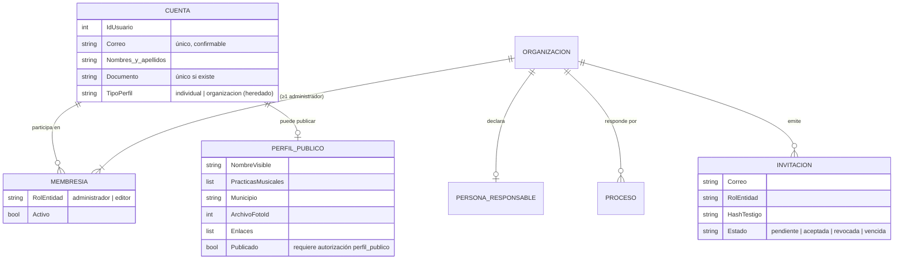

# 19. Modelo de cuentas, organizaciones, membresías y roles

**Estado: aprobado** el 2026-11-05 por la dirección del proyecto. Fija la relación entre
persona, cuenta, organización y membresía para el MVP.

## 19.1 Decisiones

| # | Pregunta | Decisión |
|---|---|---|
| 1 | ¿Registro individual sin organización? | **Sí.** Una persona puede crear solo su cuenta. |
| 2 | ¿Una cuenta responde por varias organizaciones? | **Sí.** Se retira la regla «una cuenta, una organización». |
| 3 | Roles dentro de una organización | **Administrador y editor.** Se retiran `propietario`, `cargador` y `lector`. |
| 4 | Regla para no dejar una organización sin responsable | **Siempre al menos un administrador activo.** |
| 5 | ¿Perfil público de la persona? | **Sí**: nombre, actividad musical, territorio, organizaciones, foto y enlaces. |
| 6 | ¿Visible por defecto? | **No.** La persona lo activa expresamente, con autorización registrada. |
| 7 | Invitaciones sin proveedor de correo | **Enlace de un solo uso** (7 días) que el administrador copia y comparte; cuando haya correo, además se envía. |

## 19.2 Entidades y relaciones

- **Cuenta = persona.** `dbo.Usuarios` ya guarda los datos de la persona; no se crea otra entidad.
- **Membresía** = fila activa de `dbo.UsuariosEntidades`. Una cuenta puede tener membresías en
  varias organizaciones, con roles distintos en cada una.
- **Persona responsable** (`dbo.EntidadesResponsable`) sigue siendo un dato declarado de la
  organización (quien la representa legalmente). No es un permiso: no tiene por qué tener cuenta.
- **Organización sin ninguna membresía** solo existe cuando la crea la consola y queda «por
  reclamar» (`AltaAdministrativa`); la reclamación crea su primer administrador.
- **Reclamar un proceso histórico** (Festival o Mercado) lo pide una organización, desde la herramienta «Procesos históricos» de su
  panel (pestaña Herramientas, docs/referencia/20-decisiones-y-flujos-por-modulo.md decisión 74). Quien aún no tiene organización llega a la herramienta de su
  espacio, que le dice que debe registrar una o unirse a una (decisión 75).

## 19.3 Permisos por rol

| Acción en una organización | Administrador | Editor |
|---|---|---|
| Ver la organización y sus procesos | Sí | Sí |
| Crear y editar borradores (Festivales, Mercados, ediciones) | Sí | Sí |
| Anunciar y editar eventos (un evento se entrega al Programa al crearlo) | Sí | No |
| Atender ajustes pedidos por el Programa | Sí | Sí |
| Enviar a revisión, reenviar, retirar, proponer cambios sobre lo publicado | Sí | **No** |
| Editar datos de la organización y la persona responsable | Sí | No |
| Invitar, cambiar roles, quitar miembros | Sí | No |
| Cerrar la organización (con motivo) | Sí | No |
| Salir de la organización | Sí, salvo si es el último administrador | Sí |

**Regla del último administrador:** ninguna operación (quitar, rebajar a editor, salir, desactivar la
cuenta) puede dejar una organización activa sin administradores activos. Se comprueba en el
servidor, como el candado del último webmaster (`CandadoDelUltimoWebmasterTests`).

En código: `RolesDeEntidad.QueResponden = ["administrador"]` y una guarda nueva
`PuedeEditarAsync` (administrador o editor) para crear y editar borradores. Enviar y decidir siguen
con `PuedeAdministrarAsync`.

## 19.4 Ciclos de vida

**Cuenta.** Registro individual (`TipoPerfil = individual`) o registro con organización (como hoy:
crea cuenta, organización y la deja como administradora). En ambos casos se confirma el correo
igual que hoy (dispensado en modo demo). Una cuenta sin membresías ve el aviso de con dos
caminos: registrar una organización o esperar una invitación.

**Organización.** Se mantiene su ciclo propio: `pendiente_de_confirmacion → activa → inactiva →
eliminada` (`EstadosDeOrganizacion`), que **no** es el ciclo editorial (`docs/desarrollo/13-nucleo-de-procesos.md` §13.6).

**Invitación.** `pendiente → aceptada | revocada | vencida`. Testigo aleatorio, se guarda solo su
resumen (como `ConfirmacionesDeCorreo`), un solo uso, 7 días; una pendiente por correo y
organización. Al aceptar: si la persona tiene cuenta, se crea la membresía; si no, se registra como
cuenta individual y después se crea. **Solo puede aceptarla la cuenta cuyo correo coincide con el
invitado** (comparación normalizada: sin espacios y sin distinguir mayúsculas). Con otra cuenta, el
servidor rechaza la aceptación (`409`, `estado = correo_distinto`) y la página de la invitación dice a
qué correo se envió —enmascarado parcialmente— y cómo entrar con esa cuenta o crearla. La consulta
anónima de la invitación también devuelve el correo enmascarado: un enlace reenviado no revela la
dirección completa. La bitácora sigue registrando el correo invitado y el de la cuenta que acepta.
Decisión de la dirección del 2026-11-05 (revisión de interfaz): sustituye a la regla anterior,
que no exigía coincidencia.

De la invitación solo se guarda el resumen del testigo, así que el enlace de una **pendiente no se puede
volver a mostrar**: el administrador usa «Generar enlace nuevo» (`POST …/equipo/invitaciones/{id}/enlace-nuevo`),
que cambia el testigo de la misma invitación, reinicia los 7 días, deja de servir el enlace anterior, vuelve
a encolar el correo y queda en la bitácora (`invitacion_enlace_nuevo`). Quien llega sin cuenta crea una
cuenta personal sin elegir tipo y se le dice a qué organización, con qué rol y a qué correo (enmascarado, por
la regla anterior: no se prellena); al terminar vuelve a la invitación. Al aceptar, el panel da la
bienvenida con el rol («Te uniste a X como editor»). Una invitación que no sirve ofrece siempre una salida
(ingresar, mis organizaciones, inicio).

**Perfil público.** Nace oculto. Se publica cuando la persona lo activa y acepta la finalidad
`perfil_publico` (nueva en `dbo.PoliticasDatos` y en `CK_AutorizacionesDatos_Finalidad`). Retirar la
autorización lo oculta en el acto. La consola puede ocultar un perfil con motivo (moderación), sin
editarlo.

## 19.5 Datos públicos, privados y verificables

| Dato | Público (si el perfil está activo) | Privado | Verificable |
|---|---|---|---|
| Nombre visible | Sí | — | No |
| Actividad musical (prácticas del catálogo) | Sí | — | No |
| Municipio | Sí | — | No |
| Organizaciones en las que participa | Sí, solo organizaciones activas | — | Sí (membresía) |
| Foto | Sí | — | No |
| Enlaces (hasta 5, `https`) | Sí | — | No |
| Correo, documento, teléfono | **Nunca** | Sí | Correo: sí (confirmación) |
| Rol dentro de cada organización | No | Sí (equipo de la organización y consola) | — |

La foto usa el Banco de archivos, como ya hace la organización con `Entidades.ArchivoFotoId`.

## 19.6 Compatibilidad con lo existente

| Hoy | Cambio | Riesgo y mitigación |
|---|---|---|
| `RolEntidad` admite 5 valores; el código escribe `administrador` | CHECK pasa a `administrador`, `editor`. Las filas `propietario` (solo semillas) pasan a `administrador`; `lector`/`cargador` no existen en datos | Migración con conteo antes y después; revisar semillas |
| «Una cuenta, una organización» en `POST /externo/organizaciones/` y `UnCorreoUnaOrganizacionTests` | Se retira; la ruta crea la organización y la membresía de administrador para la cuenta que llama | Se conserva el correo de contacto único por organización (`UX_Entidades_CorreoContacto`) |
| El panel ya tiene selector (`hayVariasOrganizaciones`) y guardas por organización | Sin cambio de fondo; probar con dos organizaciones | Pruebas de aislamiento entre organizaciones |
| `TipoPerfil` siempre `organizacion` | Admite `individual` | Valor nuevo; ningún código lo lee hoy |
| `UsuariosCodigosVerificacion` sin uso | No se reutiliza; las invitaciones tienen su tabla | Retirarla en una limpieza aparte |

## 19.7 Rutas del panel: la organización activa en la URL 

Decisión clave 1 de la revisión de interfaz (, –). La
organización activa es **una sola fuente de verdad y vive en la dirección**; lo de la persona tiene
su propio espacio, sin pestañas de organización.

| Dirección | Qué es |
|---|---|
| `/gestion` | Lleva a la organización por omisión (`/gestion/o/{id}/resumen`); sin organizaciones, a `/gestion/cuenta`. |
| `/gestion/cuenta` | **Mi espacio**: bienvenida tras registrarse (`?bienvenida=1`), siguientes pasos y accesos. |
| `/gestion/cuenta/organizaciones` | **Mis organizaciones**: cada una con su rol y su panel, «Registrar una organización» e invitaciones pendientes (`GET /api/v1/externo/cuenta/invitaciones`, solo lectura: se aceptan con su enlace). |
| `/gestion/cuenta/organizaciones/registrar` | Registrar una organización. Al guardar abre `/gestion/o/{nueva}/resumen?registrada=1`, que confirma que ahora la administras y propone los siguientes pasos. |
| `/gestion/cuenta/perfil-publico` | Perfil público. Su foto es la única foto de la persona. |
| `/gestion/cuenta/seguridad` | Datos personales, contraseña y autorizaciones. |
| `/gestion/o/{organizacionId}/…` | El panel de UNA organización: `resumen`, `procesos`, `procesos/festivales(/nuevo, /:id)`, `procesos/mercados(/nuevo, /:id)`, `eventos`, `solicitudes`, `organizacion`, `archivos`, `equipo`. `responsable` lleva a `organizacion#responsable`. |

Reglas:

- **Solo la URL dice qué organización está abierta.** El panel copia el parámetro en
  `PanelOrganizacionStore` si la cuenta es miembro; la cabecera del portal y la campana lo leen de la
  dirección (`ContextoDeOrganizacionService`). Recargar o compartir el enlace conserva la organización.
- **Cambiar de organización es navegar** a la misma sección de la otra (desde una ficha o un
  asistente, a la lista de ese proceso). El armazón se reconstruye (`ReutilizacionDeRutas`): nada
  escrito en una organización viaja a otra. Si un asistente tiene algo escrito, se pregunta antes
  (`confirmarCambioDeOrganizacion`); el de Festival guarda lo pendiente como borrador de SU
  organización y el de Mercado avisa de que se perderá.
- **Un enlace a un registro de otra organización de la cuenta** abre esa organización con un aviso
  («Cambiamos a …»). Una organización de la que la cuenta no es miembro se dice con claridad, sin
  pintar secciones.
- **Las direcciones antiguas** (`/gestion/resumen`, `/gestion/procesos/festivales/92?…`, etc.) llevan a
  la misma sección de la organización por omisión: la última abierta si sigue siendo de la cuenta
  (se recuerda por cuenta en el navegador) o la primera. `/gestion/cuenta-seguridad`,
  `/gestion/perfil-publico` y `/gestion/registrar-organizacion` llevan al espacio de la persona.
- **Sin sesión**, la guardia manda a `/ingresar?volver=<dirección>` y, tras ingresar, se vuelve a
  ella (solo direcciones de `/gestion`).
- **Los roles no cambian** (§19.3): el editor sigue sin ver acciones de administración en ninguna
  organización; el rol se lee de la organización de la URL.

## 19.9 Recuperación de contraseña de las cuentas externas

**Alcance.** Solo cuentas **externas** (personas y organizaciones). Las cuentas internas de la consola
**no usan este flujo**: su contraseña la restablece el webmaster desde Usuarios, y la pantalla de la consola lo
dice (antes simulaba enviar un correo que nunca salía).

### Flujo

1. `/ingresar` → «¿Olvidaste tu contraseña?» → correo → **«Revisa tu correo»** (mensaje neutro).
2. El correo lleva `…/ecosistema/restablecer-contrasena?testigo=…`. La página **comprueba el enlace antes** de
   pedir la contraseña y dice, si no sirve, por qué (venció, ya se usó, hay uno más reciente, no es válido) y
   cómo pedir otro.
3. Contraseña nueva (`PoliticaDeContrasena`: 12 a 128 caracteres, lista de claves comunes, sin el nombre ni el
   correo) → «Contraseña restablecida» → **Ingresar** (no se inicia sesión sola).

Rutas (todas anónimas): `GET /externo/auth/csrf` (el testigo antiforgery; no escribe nada y por eso no lleva
limitador), y con el limitador `external-recuperacion` `POST /externo/auth/olvide-contrasena`,
`POST /externo/auth/restablecer-contrasena/comprobar` y `POST /externo/auth/restablecer-contrasena`. Tabla `dbo.RestablecimientosDeContrasena` (V20261106_80).

### Decisiones de seguridad

| Tema | Decisión |
|---|---|
| Enumeración de cuentas | La solicitud contesta **lo mismo** (202 y el mismo cuerpo) exista o no la cuenta, esté desactivada o sea interna, y tarda **al menos 450 ms** en todos los casos. El motivo real solo queda en el registro del servidor, con el correo seudonimizado. |
| Testigo | 32 bytes del generador criptográfico (**256 bits**), en hexadecimal. En la base solo su **SHA-256**; leer la tabla no sirve para restablecer nada. Viaja en el cuerpo de las peticiones, no en rutas que se pidan al servidor. |
| Vida | **60 minutos**, **un solo uso** (el `UPDATE` condicionado lo gana una sola petición) y **un solo enlace vivo por cuenta**: pedir otro invalida el anterior (índice único filtrado en la base). |
| Enlace del correo | Se arma con `Correo:UrlPublica`, **nunca con el encabezado `Host`**. Sin esa configuración (demo) queda la ruta relativa y el despachador la completa al enviar. |
| Límites | Por origen: 10 por minuto (`external-recuperacion`, el mecanismo de las puertas externas). Por cuenta: **3 solicitudes por hora y 2 minutos entre una y otra**, contadas sobre la tabla (valen con varias instancias). Pasado el tope **no se emite otro enlace ni se contesta distinto**: el último que llegó al buzón sigue sirviendo, así que un tercero no puede dejar a nadie sin recuperar la cuenta ni llenarle el buzón. |
| CSRF | La solicitud y el restablecimiento exigen el testigo antiforgery (`X-CSRF-TOKEN`) obtenido por la ruta anónima `GET /externo/auth/csrf`. |
| Sesiones | Cambia el hash de la contraseña y con él el sello `simus:sello` de toda cookie externa; `RevalidacionDeSesion.Invalidar` hace que valga desde la siguiente petición. Las demás sesiones quedan cerradas. No se inicia sesión al restablecer. |
| Cuentas desactivadas | **No reciben correo** (quien las desactivó decidió que no entran) y un enlace emitido antes deja de servir si la cuenta se desactiva. |
| Correo sin confirmar | **Sí recibe el enlace** si la cuenta está activa: el correo es el registrado, y así quien registró una cuenta con un correo ajeno no puede quedarse con ella (el dueño del buzón la recupera y cierra esa sesión). Restablecer **no confirma** el correo ni activa organizaciones: la confirmación sigue su propio enlace. |
| Cuentas internas | No reciben nada (se contesta como a una cuenta inexistente). Una cuenta con roles externo e interno tampoco. |
| Bitácora | Una entrada de solicitud (`restablecimiento_solicitado`) y una de restablecimiento (`contrasena_restablecida`) sobre `Usuarios`, verbo `actualizar` (`CK_BitacoraAuditoria_Accion` solo admite trece), JSON válido, **sin testigo, sin contraseña y sin correo**. También se avisa a la persona por correo del cambio. |

### Modelo de amenazas (breve)

- *Adivinar el enlace*: 256 bits y 60 minutos; con el límite por origen no es viable.
- *Saber quién tiene cuenta*: respuesta, código y tiempo iguales; el registro (`POST /externo/auth/register`) sí
  responde 409 con un correo repetido — es la superficie de enumeración que **queda** y es previa a este flujo.
- *Envenenar el enlace con `Host`*: el enlace sale de la configuración, no de la petición.
- *Inundar el buzón o invalidar el enlace de otra persona*: topes por cuenta y por origen; el tope no bloquea
  nada, solo deja de emitir.
- *Robo de sesión previo*: restablecer cierra todas las sesiones anteriores.
- *CSRF*: testigo antiforgery obligatorio; la petición solo vale con el JSON y la cabecera de nuestra página.
- *Fuga del testigo*: no está en logs ni en bitácora; viaja en la dirección del correo (la política de
  `Referer` del sitio es `strict-origin-when-cross-origin`, así que no sale a otros orígenes). Un testigo ya
  usado o vencido no sirve.

### Modo demo y pre-entrega

Sin proveedor de correo el mensaje queda en la cola (`dbo.Notificaciones`, canal `email`, estado `pendiente`),
igual que la confirmación y las invitaciones. A diferencia de ellas, **la persona no tiene sesión y no puede
leerlo en la campana**: en demo el enlace solo lo lee quien tenga acceso a la base. Con `Correo:Proveedor=Smtp`
el despachador lo envía y completa el enlace con `Correo:UrlPublica`.

## 19.10 La entrada tras iniciar sesión, el rol y el menú de cuenta (ACC2)

**Qué había.** `/gestion` llevaba, sin preguntar, a «la organización por omisión»: la última que la persona abrió
en ese navegador o la primera de la lista. Una cuenta como la de Lucía Ramírez aterrizaba dentro de una
organización aunque venía a ver su perfil, y el panel decía «Actuando como · administración» mientras el menú de
cuenta repetía «Actuando como» y ofrecía «Registrar una organización».

**Qué hay ahora.**

| Quién | Qué ve al iniciar sesión | Dónde queda |
|---|---|---|
| Cuenta **con una o más organizaciones** (administra o edita) | La pantalla **«¿Cómo quieres entrar?»** (`/gestion/entrada`): una tarjeta «Mi espacio» y una por organización, con su nombre y su rol | En «Mi espacio» (`/gestion/cuenta`) o en el panel de la organización elegida (`/gestion/o/{id}/resumen`) |
| Cuenta **sin organización** | Nada que elegir: pasa de largo | Directo a «Mi espacio» (`/gestion/cuenta`); la dirección de entrada no queda en el historial |
| Quien llega con un **destino pedido** (`?volver=`, una invitación pendiente) | El destino pedido, sin pasar por la pantalla de entrada | Donde pidió |
| Quien abre `/gestion` desde la cabecera, o una dirección antigua | La organización por omisión, como antes | La última organización abierta |

- **La elección se recuerda solo para preseleccionar.** La tarjeta de «la última vez» recibe el foco y una nota; la
  pantalla se muestra igual en cada inicio de sesión nuevo. Entrar a «Mi espacio» por cualquier puerta lo deja como
  último modo, sin cambiar la organización por omisión.
- **La organización activa sigue viviendo solo en la URL** (§19.7); la pantalla de entrada no es otra fuente de verdad.
- **El rol se dice solo, con su palabra:** «Administrador» o «Editor», en el panel, el menú de cuenta, «Mis
  organizaciones» y la entrada. Desaparece «Actuando como».
- **El menú de cuenta** (cabecera) muestra el **nombre de la organización activa** (por ejemplo «Corporación Cultural
  Cantaclaro») en lugar de «Actuando como …», lista las demás organizaciones con su rol para cambiar, y ofrece «Mi
  espacio». **No incluye «Registrar una organización»**: esa acción queda en Mi espacio → Mis organizaciones.
- Cambiar de modo después de entrar se hace desde ese menú.

Decisiones 70 a 72 de `docs/referencia/20-decisiones-y-flujos-por-modulo.md`.

## 19.11 Mi espacio: arquitectura y diseño de pantallas (ME)

**Qué cambia.** El espacio personal (`/gestion/cuenta`) deja de ser cuatro pestañas horizontales con contenido en una columna estrecha y pasa a una **navegación lateral por grupos** con el contenido a todo el ancho:

| Grupo | Pantallas | Dirección |
|---|---|---|
| Mi cuenta | Resumen · Perfil público · Datos personales · Seguridad y autorizaciones | `/gestion/cuenta`, `/perfil-publico`, `/datos`, `/seguridad` |
| Participación | Mis organizaciones (con las invitaciones) | `/gestion/cuenta/organizaciones` |
| Mis procesos | Talleres de lutería · Espacios · Redes y documentación (y, más adelante, la agenda de citas) | `/gestion/cuenta/talleres`, `/espacios`, `/redes` |

- **Resumen.** Dice en qué está la cuenta con tres pasos: correo confirmado, datos personales completos y perfil público. Solo los dos primeros cuentan para el avance; el perfil público es opcional, porque la persona decide si se muestra. Cada paso lleva su estado y su siguiente acción.
- **Datos personales y Seguridad y autorizaciones** pasan a dos pantallas del mismo componente (`data.vista`). Antes todo se apilaba en una columna de 36 rem; ahora los datos usan una cuadrícula con un lateral (correo de acceso y aviso de privacidad), y la seguridad reúne contraseña, autorizaciones y cierre de sesión en dos columnas. Las direcciones `/gestion/cuenta-seguridad` y `/gestion/cuenta/seguridad` siguen vivas.
- **Dos modos que no se mezclan.** La persona gestiona lo suyo desde «Mi cuenta» y cada organización desde su panel (`/gestion/o/{id}`). El resumen da acceso rápido a cada organización con el rol (Administrador o Editor) y lista aparte lo que la persona registra a título propio. El selector de modo de entrada y el menú de cuenta son de otro lote (ACC2) y no se tocan aquí.

**Referencia: «Soy Cultura».** Es el Registro Único Nacional de Agentes Culturales del Ministerio de las Culturas, creado por el artículo 18 de la Ley 2070 de 2020 (`soycultura.mincultura.gov.co`). **[Visto en resultados de búsqueda; no se pudo abrir la plataforma]**. De lo que se pudo leer solo se toman ideas de organización, no diseño ni marca: la persona se registra con un correo personal y **actualiza su información en cualquier momento**, y puede **pedir la cancelación** de su inscripción (de un proyecto de resolución de 2020, por confirmar en la plataforma). No se encontró cómo organiza sus perfil, datos personales y seguridad, así que el diseño de pantallas es propio y queda por contrastar con la plataforma real.

## 19.12 Perfil público enriquecido (ME)

**Qué cambia.** El perfil público de una persona pasa de cinco campos (nombre, prácticas, municipio, foto, enlaces) a una ficha completa, con una pantalla de dos columnas: el formulario a la izquierda y, a la derecha, el estado, **quién ve el perfil**, la vista previa fiel y el historial.

| Campo | Regla |
|---|---|
| Nombre artístico y nombre civil | El artístico es el nombre visible. El civil se muestra **solo si la persona lo consiente** con una casilla; se toma de su cuenta, no se escribe aquí. |
| Biografía corta y larga | Hasta 280 y 4000 caracteres, con contador. |
| Roles y oficios | Hasta 8, texto libre, sin repetidos. En la API se llaman `oficios`: la guardia de privacidad prohíbe que un DTO público tenga una propiedad «rol», que en SIMUS es el cargo dentro de una organización. |
| Portafolio | Hasta 8 elementos (audio, video o enlace) con título y dirección `https`. Las imágenes del Banco quedan para una segunda vuelta. |
| Organizaciones que decide mostrar | **Consentimiento explícito**: estar en una organización no basta, la persona la elige. Solo se muestran las públicas con membresía activa. La ficha de la organización lista únicamente a quienes la eligieron. |
| Visibilidad | `publico` (cualquiera), `solo_simus` (solo quien tiene cuenta en SIMUS; sin sesión responde el mismo 404 sin cuerpo que un perfil oculto) y oculto (retirar la autorización). La moderación de la consola prevalece siempre. |

**Historial.** Cada cambio escribe una línea en el registro de cambios (módulo `perfiles-publicos-persona`); el titular lo lee en la misma pantalla (`GET /externo/cuenta/perfil-publico/historial`, últimos 100). El nombre civil se registra como dato de contacto.

**Datos.** Migración `V20261112_40`: columnas nuevas en `PerfilesPublicos`; las listas viajan como JSON en la misma fila (con `CK … ISJSON`), sin tablas hijas, para que retiros y fusiones no choquen con llaves foráneas. La visibilidad tiene su `CK`.

**La foto sigue la visibilidad.** La imagen de un perfil «solo SIMUS» solo la sirve el Banco de archivos con sesión válida (cualquier cuenta de SIMUS, de consola o externa); sin sesión responde el mismo 404 sin cuerpo que un archivo inexistente. La de un perfil público es anónima, y la de uno oculto o sin autorización no se sirve (salvo a su dueña). Sin cambios de esquema (decisión 102 de `docs/referencia/20-decisiones-y-flujos-por-modulo.md`).

## 19.13 El directorio de personas como búsqueda (DIR)

**Qué cambia.** El espacio de las personas con perfil público deja de ser solo una ficha por dirección y pasa a ser una **búsqueda**: `/ecosistema/personas` lista a quienes publicaron su perfil, con búsqueda por texto, zona (departamento y municipio de la sede, y «Actúa en»), **tipo de servicio**, rol e instrumento, cada opción con su conteo; y la ficha muestra **«Perfiles similares»** al lado. La persona se clasifica con una taxonomía **controlada y de selección múltiple**, en «Cómo te encuentran» (`/gestion/cuenta/perfil-publico`).

**Fuente y fecha de la investigación (17 nov 2026).** **[Visto en resultados de búsqueda; no se pudo abrir la plataforma ni su formulario]** El formulario vigente de Soy Cultura (`soycultura.mincultura.gov.co`, Registro Único Nacional de Agentes Culturales, art. 18 de la Ley 2070 de 2020) no es público sin cuenta: lo único que se pudo ver es que pide «área de ocupación u oficio», experiencia y tipo de formación (proyecto de resolución de 2020; no es la norma final) y que distingue **creadores y gestores culturales** (Ley 397 de 1997, arts. 27 y 28). Por eso **no hay un código de Soy Cultura que copiar**: el catálogo declara su **grupo** (`creador`, `gestor` u `otro`) y el código exacto queda por confirmar con el Ministerio. Las funciones del sector musical salen de la **Ley 2621 de 2026** (art. 8, Directorio Violeta: «cantautoras, intérpretes, instrumentistas, docentes de música, sonidistas, compositoras, investigadoras y directoras de orquesta», «productoras» y «las demás agentes del sector»; art. 7: el registro de agentes se hace en **SIMUS**). No se encontró un listado público de instrumentos de Soy Cultura ni del Plan Nacional de Música para la Convivencia: no se inventó.

**Taxonomía** (código estable; nunca se renombra ni se reutiliza; los valores viven en la tabla `ValoresDeTaxonomiaDePerfiles`, administrable desde el Catálogo de la consola desde la decisión 133, y los de esta tabla son los iniciales). Cuatro dimensiones, todas de selección múltiple:

| Dimensión | Valores (código) | Origen |
|---|---|---|
| Roles (hasta 6), en dos niveles desde la decisión 135 (abajo) | `interprete` Intérprete o instrumentista · `cantante` Cantante o cantautor(a) · `compositor` Compositor(a) o arreglista · `director` Director(a) de agrupación u orquesta · `docente` Docente o formador(a) de música · `investigador` Investigador(a) o sabedor(a) · `luthier` Lutier o constructor(a) de instrumentos · `sonidista` Sonidista o técnico(a) de audio · `productor` Productor(a) musical o fonográfico · `gestor` Gestor(a) cultural · `cultor` Cultor(a) o portador(a) de tradición | Ley 2621 de 2026 art. 8; Ley 397 de 1997 art. 28 (`gestor`); `luthier` y `cultor` son propuestas SIMUS (docs/referencia/27-fuentes-de-luteria.md) |
| Servicios que ofrece, «qué necesito encontrar» (hasta 8) | `clases` · `presentaciones` · `grabacion` · `composicion` · `luteria` (construcción, reparación y restauración: reúne los servicios del taller de `ServiciosDeTaller`) · `sonido` · `gestion` · `direccion` · `investigacion` · `asesoria` | Propuesta SIMUS; `luteria` reutiliza docs/referencia/27-fuentes-de-luteria.md §27.4.3 |
| Instrumentos (hasta 8) | `cordofonos` · `aerofonos` · `membranofonos` · `idiofonos` · `electrofonos` · `voz` | Las cinco clases de Hornbostel-Sachs de `FamiliasDeInstrumentos` (docs/referencia/27-fuentes-de-luteria.md) y «voz». Instrumentos regionales concretos quedan fuera: ninguna fuente vista da la lista |
| Territorio de acción (hasta 10) | Código DANE del departamento | `dbo.Divipola` |

Se **reutilizan**, sin duplicar, las **prácticas musicales** (`PracticasMusicales`, ya en el perfil), la **sede** (`CodigoMunicipio` del perfil) y la familia de instrumentos. Los roles de texto libre («oficios», §19.12) se conservan para lo que la taxonomía no cubre.

**Modelo.** Migración `V20261117_60`: tabla `PerfilesPublicosClasificaciones (IdUsuario, Dimension, Codigo)` con clave foránea al perfil y `CK` de dimensión; los códigos los valida la API contra la taxonomía. Los perfiles existentes quedan **sin filas = «pendiente de completar»** (se listan y se encuentran por texto, con ese rótulo; no por servicio ni rol). Nada se borra: guardar reemplaza la selección y la bitácora registra el cambio.

**Privacidad.** El directorio lee solo los perfiles que `PerfilPublicoEndpoints.Visibles` declara visibles (autorización `perfil_publico` vigente, sin moderación; los «solo SIMUS» solo con sesión). Retirar la autorización saca a la persona de la lista y de los similares en el acto. No sale correo, documento, teléfono, nombre civil ni rol en una organización; la guardia busca esos valores en el JSON crudo.

**Roles en categorías y subcategorías (decisión 135).** Pedido de la persona: «los roles deberían tener categorías y subcategorías con múltiple selección de acuerdo con lo que podamos revisar en Soy Cultura». **Lo que se pudo revisar** (18 nov 2026): la plataforma `soycultura.mincultura.gov.co` no muestra su formulario sin cuenta y ni la búsqueda ni los documentos públicos del Ministerio consultados (proyecto de resolución de 2020, ABC de la Ley de Oficios, documento de caracterización del sector de la música) traen un catálogo de roles con subcategorías; lo único confirmado es que distingue creadores y gestores (Ley 397 de 1997, arts. 27 y 28), que pide «área de ocupación u oficio» y que Música es el área más declarada. **Por eso la estructura es una propuesta SIMUS y no se inventó ningún código oficial: «pendiente de confirmar con el Ministerio».**

| Categoría (código nuevo) | Subcategorías (códigos de siempre) | Grupo |
|---|---|---|
| Creación e interpretación (`creacion-e-interpretacion`) | `interprete` · `cantante` · `compositor` · `director` · `cultor` | creador |
| Formación e investigación (`formacion-e-investigacion`) | `docente` · `investigador` | otro |
| Técnica, lutería y producción (`tecnica-luteria-y-produccion`) | `luthier` · `sonidista` · `productor` | otro |
| Gestor(a) cultural (`gestor`) | sin subcategorías: se elige a sí misma | gestor |

**Reglas.** Dos niveles y solo en roles (`IdPadre`, `V20261118_30`). Se eligen subcategorías, varias y de categorías distintas (máximo 6 roles); una categoría con subcategorías no se elige sola (`400`: «Elige una subcategoría de …»). Una subcategoría se ofrece solo si ella y su categoría están activas; la persona que ya la tenía la conserva. La categoría de una persona se deduce de sus roles y no se guarda. **Catálogo**: árbol con «Añadir subcategoría»; cambiar de categoría es `POST /institucional/taxonomia-de-perfiles/{id}/categoria`. **Lectura**: `GET /publico/taxonomia-de-perfiles` trae `padre` en cada rol y `rolesPorCategoria` en árbol. **Directorio**: filtro «Categoría de rol» (`?categoria=`), que acepta a quien tenga cualquiera de sus subcategorías, junto al filtro de rol. **Similares**: comparten categoría aunque la subcategoría sea otra, +1 («Misma categoría: …»). El selector del perfil y del registro (`app-selector-de-categorias`) agrupa las opciones bajo el título de su categoría con `app-selector-multiple` (`grupo` opcional en `OpcionSeleccionable`).

**Perfiles similares.** Comparten al menos un servicio, rol, instrumento o práctica; la zona solo suma si ya hay algo en común. Pesos: servicio 3, rol 2, instrumento 2, práctica 1, mismo municipio +2, mismo departamento +1. Hasta seis, sin la misma persona ni perfiles no públicos; cada una dice en qué coincide y el servidor entrega el criterio en palabras.

**Dónde vive la puerta.** El menú Ecosistema solo lista procesos y sin cifras (decisión 118) y las personas no son un proceso: el acceso es una franja «Encuentra a quien necesitas» en la portada del Ecosistema y el enlace «Buscar más personas» de cada ficha. **Registro.** La cuenta personal puede elegir las categorías al registrarse (opcional, con la misma pieza que el perfil): `POST /externo/auth/register` acepta `clasificacion` y crea un perfil **oculto** (sin autorización no se indexa). **Filtros:** tipo de servicio, rol e instrumento son de selección múltiple. **Diferido:** paginación en el servidor (la lista llega completa, como en los demás directorios). **Pendiente externo:** el código oficial de Soy Cultura por rol, categoría y subcategoría, que debe dar el Ministerio.

## 19.14 Datos personales de la cuenta y nombre civil del perfil público (DAT)

**Qué pidió el usuario (18 nov 2026).** En «Mi espacio · Datos», incluir más datos personales como municipio y departamento de vivienda (opcional) y otros viables y coherentes; y en «Perfil público», que mostrar el nombre civil junto al artístico se vea de verdad.

**Criterio: minimización.** Solo se agrega un dato si tiene una finalidad concreta que SIMUS ya cumple, es opcional y se guarda aparte de lo público. Cada campo nuevo, con su finalidad:

| Campo | Columna | Finalidad | Regla |
|---|---|---|---|
| Departamento y municipio de residencia | `Usuarios.ResidenciaCodigoDepartamento` (`char(2)`) y `ResidenciaCodigoMunicipio` (`char(5)`) | Mostrar lo que ocurre en su territorio y conocer, de forma agregada, de dónde vienen quienes usan SIMUS. No es la sede de un proceso ni el municipio del perfil público. | Opcional. Del catálogo DIVIPOLA con el selector de territorio común (`app-selector-de-sede`); el municipio exige el departamento y debe pertenecerle (`CK` y clave foránea). Vacío lo borra. |
| Medio de contacto preferido | `Usuarios.CanalDeContactoPreferido` (`correo` o `telefono`) | Que el equipo escriba por el medio que la persona prefiere cuando una solicitud suya lo requiera. | Opcional. Preferir el teléfono exige tener teléfono. |

**Lo que no se pide, y por qué.** Fecha de nacimiento (sin base legal ni uso: la edad no condiciona nada en SIMUS), sexo o género, pertenencia étnica, discapacidad (datos sensibles de la Ley 1581 de 2012 sin finalidad que los justifique), dirección exacta y barrio (más precisión de la que ninguna función necesita). Si una función futura los necesita, se decide aparte, con su base legal y su consentimiento.

**Privacidad.** Son privados como el resto de la cuenta (§19.2): solo la persona los lee y los cambia (`GET` y `PUT /externo/cuenta/perfil`, sesión externa y testigo CSRF); no salen en el perfil público, en el directorio de personas ni en ninguna ficha, ni siquiera con el consentimiento del nombre civil. La consola los ve solo como datos personales con Auditoría de acceso. No se borra nada de forma automática.

**Datos.** Migración `V20261118_20`: tres columnas nulables en `Usuarios`, con `CK` de coherencia, `CK` del medio y clave foránea a `Divipola`. Aditiva e idempotente; ninguna cuenta anterior queda incompleta.

**Pantalla.** «Datos personales» agrega el bloque «Dónde vives y cómo prefieres que te contacten», con la finalidad dicha en la propia pantalla. La carga dibuja el esqueleto de la ficha; si falla, un error con «Reintentar» (nunca un formulario vacío que parezca borrado).

**Defecto corregido: «Mostrar mi nombre civil» no hacía nada.** El nombre civil se armaba solo con las cuatro partes del nombre (`PrimerNombre` a `SegundoApellido`). Las cuentas anteriores a ese modelo, y las de organización, solo tienen `FullName`: para ellas `NombreCivilPropio` salía vacío, la vista previa no mostraba nada y la ficha pública tampoco, aunque la casilla se guardara. Ahora, sin partes, se usa `FullName`; y si la cuenta no tiene ningún nombre, la casilla se apaga y manda a «Datos personales» en vez de no hacer nada.
