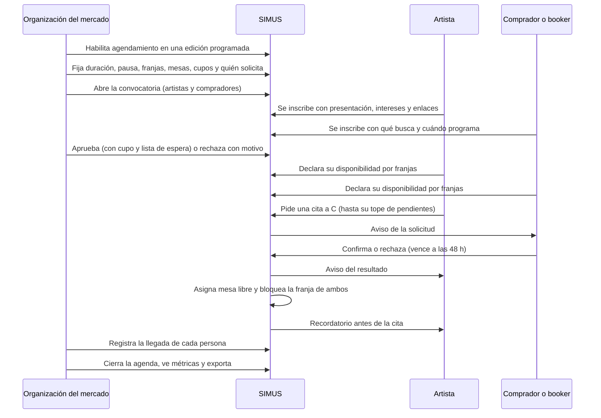
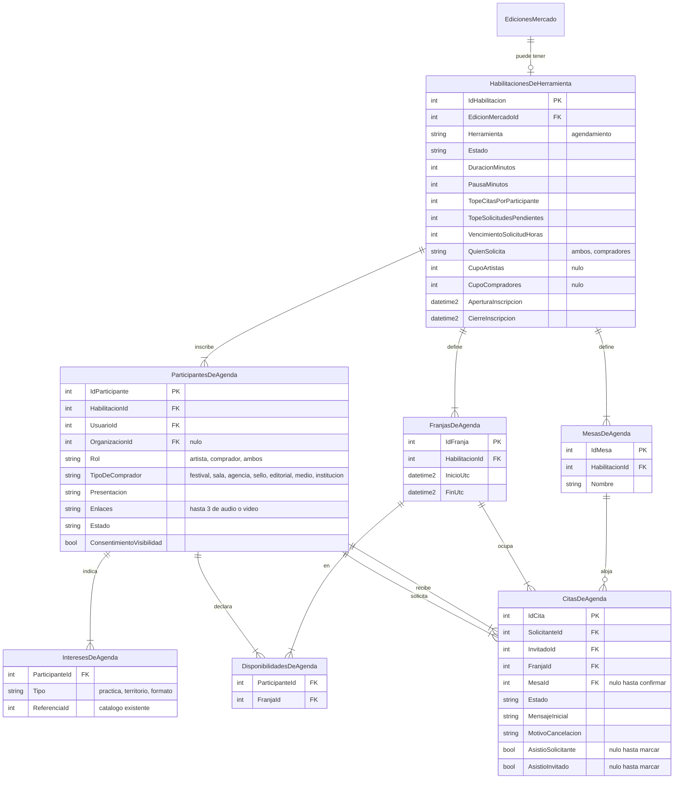
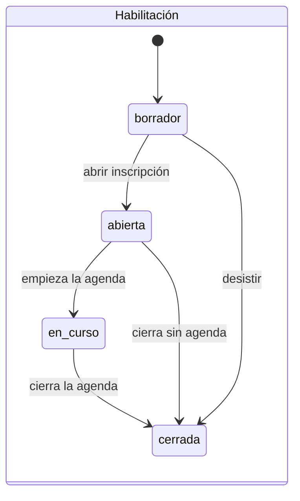
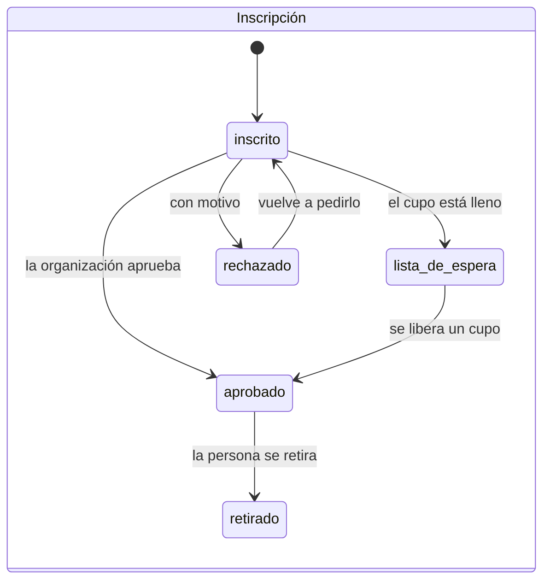
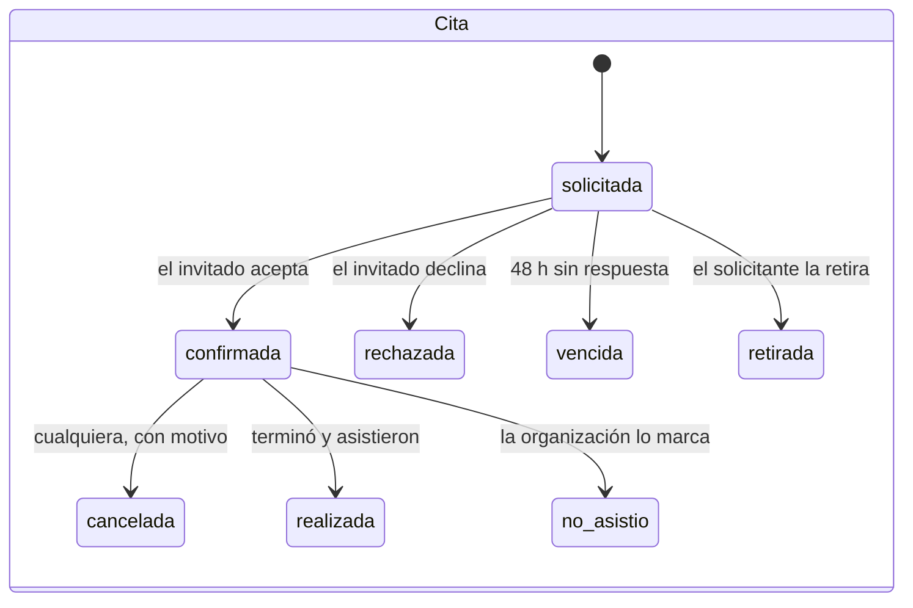
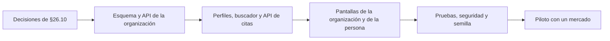

# 26. Herramientas y agendamiento de mercados (diseño del piloto)

**Estado (versión 1.3, 12 de noviembre de 2026): el piloto está construido** (§26.12); lo que sigue en este
documento es el diseño que lo guió, con las decisiones tomadas por la dirección el 11 de noviembre
marcadas en §26.10 y §26.12.

Documento de diseño. Propone un apartado
nuevo, **Herramientas**, y su primer caso: un sistema de agendamiento de **citas entre artistas y
posibles compradores o bookers** durante los mercados musicales, que funcione dentro de SIMUS. El caso
de uso quedó **confirmado por la dirección el 10 de noviembre de 2026** (versión 1.1). Esta versión lo
contrasta con referencias de cómo funcionan otras plataformas y mercados (§26.2.2) y ajusta el diseño.
Está escrito para que la dirección elija qué entra en la entrega de noviembre de 2026 y qué espera.

## 26.0 Cómo leer este documento

Cada afirmación lleva su origen, para que se vea qué está establecido y qué es una propuesta:

| Marca | Significa |
| --- | --- |
| **[Documento]** | Está en la documentación del repositorio (se cita cuál). |
| **[Código]** | Existe hoy en el código o en el esquema de la base (se cita dónde). |
| **[Confirmado]** | Lo confirmó la dirección (se cita la fecha). |
| **[Referencia]** | Lo describe una fuente externa. Va con su grado de verificación, abajo. |
| **[Supuesto]** | Lo propongo yo para poder diseñar; la dirección lo confirma o lo cambia. |

Grados de verificación de una **[Referencia]**:

| Grado | Significa |
| --- | --- |
| **[Verificado: abrí la página]** | Abrí la página y leí el pasaje. **Ninguna referencia de esta versión tiene este grado** (ver el límite, abajo). |
| **[Visto en resultados de búsqueda]** | Leí el extracto que devolvió el buscador, con su dirección; no abrí la página. |
| **[No verificado]** | Lo busqué y no apareció, o apareció solo de forma indirecta. |

**Límite de la investigación.** Para la versión 1.1 solo dispuse de búsqueda web: no pude abrir las
páginas. Por eso todo lo externo es, como mucho, **[Visto en resultados de búsqueda]**. Las cifras y
las reglas de cada evento cambian por edición y las publican sus propios organizadores o proveedores
(con intereses comerciales, en el caso de las plataformas); conviene confirmarlas en su sitio oficial
antes de citarlas fuera de este documento. Los pasos de verificación están en §26.2.2.

**Sobre el origen del pedido.** El 10 de noviembre de 2026 se pidió «un apartado de herramientas dentro
de SIMUS para generar un piloto de un sistema de agendamiento como lo que hablamos para mercados
musicales». La versión 1.0 no encontró ningún registro previo de esa conversación (ni,
 bloque 5, `docs/usuario/06-modulos-y-funcionalidades.md`, `docs/atlas-main`, el backlog y el catálogo de decisiones, ni en las
sesiones guardadas) y trató el caso como **[Supuesto]**. El mismo día la dirección **confirmó** que el
caso es el agendamiento de **citas entre artistas y posibles compradores o bookers**, y pidió revisar
referencias de cómo funciona. **[Confirmado]** (10 nov 2026). Lo que sigue siendo **[Supuesto]** son los
detalles del flujo, las reglas y el modelo, que §26.10 deja para decidir.

---

## 26.1 Qué es el apartado Herramientas

### Definición

**Una herramienta es una capacidad de trabajo que se apoya en un proceso ya existente y no es un proceso
nuevo del Ecosistema.** **[Supuesto]**

La diferencia importa porque el proyecto ya tiene una forma de crear procesos (Festivales, Mercados,
con registro, revisión, publicación, historial y retiro; [13 · Núcleo reutilizable de procesos](../desarrollo/13-nucleo-de-procesos.md))
y una declaración obligatoria para cada uno (§13.9). El agendamiento **no** se registra, **no** se
revisa para publicarse y **no** aparece en el directorio público como un registro propio: ocurre
**dentro** de una edición de un Mercado que ya existe. Tratarlo como proceso lo cargaría de un circuito
que no necesita.

| | Proceso del Ecosistema | Herramienta |
| --- | --- | --- |
| Ejemplos | Festival, Mercado | Agendamiento de citas, procesos históricos |
| Tiene directorio y ficha públicos | Sí | No |
| Pasa por revisión institucional | Sí (Festival y Mercado; las ediciones de Mercado no) **[Código]** | No |
| Vive dentro de | El Ecosistema | Una edición de un proceso publicado |

**Procesos históricos (decisión 129).** La primera herramienta de la pestaña, antes «Festivales históricos», busca y reclama la administración de un proceso registrado de antes sin organización: los cinco tipos de proceso (Festivales, Mercados, Redes y documentación, Lutería y Espacios; decisión 131). No abre con lista: solo el buscador y, si el servidor ve una coincidencia fuerte con la organización, la sugerencia con su motivo. Su ruta es `/gestion/o/{id}/herramientas/procesos-historicos`; la de antes redirige.
| Se enciende | Al publicarse | La organización la habilita por edición |

### Dónde vive y quién ve qué

Hoy el panel de una organización cuelga de `/gestion/o/:organizacionId/…` y ya tiene `resumen`,
`organizacion`, `archivos`, `procesos/festivales` y `procesos/mercados` **[Código]** (`app.routes.ts`).
La consola tiene los módulos de [`ModulosDeLaConsola`](../../simus-api/src/SIMUS.Api/Security/ModulosDeLaConsola.cs)
**[Código]**. Propuesta de navegación **[Supuesto]**:

| Puerta | Ruta propuesta | Quién entra | Qué ve |
| --- | --- | --- | --- |
| Panel de la organización | `/gestion/o/:organizacionId/herramientas` | Administrador y editor de la organización responsable del Mercado | Las herramientas disponibles y, por cada edición de sus Mercados, si están habilitadas |
| Panel de la organización | `/gestion/o/:organizacionId/herramientas/agendamiento/:edicionId` | Igual | Configuración, participantes, franjas, mesas y la cuadrícula de citas |
| Espacio de la persona | `/gestion/cuenta/agenda-de-citas` | Cualquier cuenta con una inscripción aceptada | Solo **su** agenda: sus citas y sus solicitudes |
| Portal público | La ficha de la edición del Mercado | Cualquiera | Una línea: «Esta edición tiene agenda de citas» y cómo inscribirse. **Nunca** la agenda ni los nombres inscritos |
| Consola | Sin pantalla propia en el piloto | Equipo institucional | Solo la bitácora; ver §26.9 si se quiere un módulo de supervisión |

Lo que se mantiene de las reglas vigentes:

- La organización activa sale de la URL, no de un estado oculto **[Documento]** (`docs/desarrollo/19-cuentas-y-organizaciones.md`).
- Administrador y editor pueden crear y editar; solo el administrador invita o cambia roles
  **[Documento]** (`docs/desarrollo/19-cuentas-y-organizaciones.md` §19.3).
- Una cuenta sin correo confirmado no opera **[Código]** (puerta compartida citada en `docs/desarrollo/13-nucleo-de-procesos.md` §13.10).
- Las acciones destructivas usan el diálogo de confirmación común y los textos siguen la
  [guía de estilo](../usuario/23-guia-de-estilo-de-textos.md) **[Documento]**.

### Principios de diseño

1. **Cuelga de una edición**, no de un Mercado: las citas de 2026 no se mezclan con las de 2027.
2. **Apagada por omisión.** Nada se ve ni se recoge hasta que la organización la habilita.
3. **Privada por omisión.** Lo público es la existencia de la herramienta, no su contenido.
4. **Reutiliza lo que ya hay:** notificaciones, bitácora, Banco de archivos y vocabularios; no crea
   mecanismos paralelos (el mismo espíritu de [13](../desarrollo/13-nucleo-de-procesos.md) y [14](../desarrollo/14-sistema-de-diseno.md)).
5. **Pequeña y probada antes que amplia:** un solo tipo de cita en el piloto.

### Catálogo de herramientas

El apartado nace con una sola entrada. Dejo anotado el patrón para que otras entren después sin
rediseñarlo **[Supuesto]**:

| Herramienta | Estado | Nota |
| --- | --- | --- |
| Agendamiento de citas | **Piloto propuesto** | Este documento |
| Otras (inscripción masiva, control de asistencia, etc.) | No propuestas | No hay pedido ni documento que las respalde; no se diseñan aquí |

---

## 26.2 El caso de uso: citas entre artistas y compradores o bookers en un mercado musical

### 26.2.1 Qué es y a quién sirve **[Confirmado]**

Durante un mercado musical se programan reuniones breves entre **artistas** (personas o agrupaciones que
buscan circulación, programación o contratación) y **posibles compradores o bookers** (quienes programan
o contratan para un festival, una sala, una agencia, un sello o un medio). Es lo que en otros mercados se
llama rueda de negocios o citas de negocios. Ocurre **dentro de SIMUS**, en una edición de un Mercado
que ya está registrado (§26.3).

Términos que uso, para evitar ambigüedad **[Supuesto]**:

| Término | Significado en este documento |
| --- | --- |
| **Artista** | Persona o agrupación inscrita para ofrecer su proyecto (antes lo llamé «ofertante») |
| **Comprador o booker** | Quien programa o contrata para un espacio, festival o empresa. **Pendiente de confirmar:** si «booker» incluye a quien representa artistas (lado vendedor); ver decisión 1 de §26.10 |
| **Cita** | Reunión de duración fija entre un artista y un comprador, con franja y mesa |
| **Mesa** | Lugar físico (o sala) donde ocurre la cita |

### 26.2.2 Referencias consultadas

Todas **[Referencia]** con grado **[Visto en resultados de búsqueda]**, salvo donde se dice otra cosa.
Las cifras son las que publican los propios organizadores o proveedores.

| Referencia | Qué se vio | Qué se adopta (o se evita) en SIMUS |
| --- | --- | --- |
| **Brella** (plataforma). [help.brella.io](https://help.brella.io/en/organizers/choose-how-your-attendees-suggest-a-meeting-to-their-matches), [cancelar](https://help.brella.io/how-can-i-cancel-meetings) | Reuniones 1 a 1 por franjas que fija el organizador o por chat; el invitado acepta, rechaza o cancela; una solicitud pendiente **mantiene la franja ocupada** hasta que se responde; dejarlas pendientes baja la puntuación de afinidad; cancelar libera la franja para ambos y admite un mensaje con el motivo; el organizador puede cancelar desde su panel; existe un programa de compradores invitados donde el organizador agenda | Solicitud pendiente que reserva y **vence**; cancelación **con motivo** que libera a ambos; el organizador puede cancelar. La agenda armada por el organizador queda como variante B (después) |
| **Swapcard** (plataforma). [ayuda](https://help-attendees.swapcard.com/en/articles/8185472-how-to-book-a-meeting) | «Reservar una reunión» desde el perfil: se elige franja y lugar y se puede añadir un mensaje; el invitado acepta o rechaza desde el detalle o la pestaña de reuniones; **no se edita en el lugar:** se cancela y se solicita de nuevo (también hay reprogramar); sincronía con Google Calendar; avisa de conflictos de equipo | Mensaje opcional en la solicitud; cambiar una cita es cancelar y volver a pedir; `.ics` ahora, sincronía con calendarios externos después |
| **b2match** (plataforma). [modos](https://support.b2match.com/en/request-mode-and-scheduling-mode), [mesas](https://www.b2match.com/features/table-management) | El organizador define sesiones (sugiere mañana y tarde, de 20 a 30 minutos por reunión) y **cuántas mesas hay por sesión**, para no sobrevender; al elegir hora el sistema **asigna la mesa**; modos de reserva: por solicitud o programada por el organizador; al terminar se **publica** el cronograma; se exporta por mesas; advierte que la libre elección de franjas puede repartir mal las reuniones | Mesas por franja asignadas por el sistema; agenda **publicada** por la organización; exportación por mesas; duración uniforme |
| **Grip** (plataforma). [MustMeet](https://grip.events/mustmeet), [límites](https://support.grip.events/what-are-meeting-limits) | Reuniones 1 a 1, de uno a muchos o de muchos a muchos; compradores invitados; puntuación de afinidad que el organizador puede ajustar; **límites de reuniones** por participante; afirma que agendar con antelación reduce las ausencias (afirmación del proveedor) | **Tope de citas** por participante. Se evita el puntaje automático en el piloto |
| **Whova** (plataforma). [anuncio](https://whova.com/blog/whova-meeting-scheduler-makes-event-more-productive/) | El asistente propone ventanas de tiempo y lugar con un formulario. **No** apareció la pantalla de aceptar o rechazar. En otras plataformas de la misma búsqueda (Exponaut, EventsCase) se rechaza con una respuesta predefinida o libre, o se rechaza y se propone otra hora | Rechazo con motivo breve. «Proponer otra hora» queda para una versión posterior |
| **Expoplatform** (plataforma). [ajustes](https://help.expoplatform.com/admin-home/meeting-settings-and-blocked-times) | Duración máxima de la reunión (1 hora por omisión), **pausa entre reuniones** y **vencimiento automático** de solicitudes (72 horas por omisión) | Pausa y vencimiento **configurables** por edición |
| **Rio2C** (Brasil), rondas de música. [reglamento](https://www.rio2c.com/mercado/regulamento-rodadas-de-musica), [guía](https://www.rio2c.com/mercado/guia_de_musica), [2026](https://billboard.com.br/rio2c-2026-abre-inscricoes-para-o-mercado-de-musica/) | Reuniones individuales de **20 minutos** entre artistas, empresarios y actores del mercado (gravadoras, sellos, editoras, agregadoras, promotores); **inscribirse no garantiza reuniones:** quienes compran eligen a quién ver según su perfil e interés; la agenda se publica en la plataforma del evento y los participantes **no pueden cambiar los horarios**; los seleccionados deben **registrar su llegada** en un mostrador al menos 20 minutos antes de la primera reunión; hasta dos representantes acreditados por proyecto; en 2026 la selección combina una comisión de música y un voto popular | Decir con claridad «inscribirse no garantiza una cita»; **registro de llegada** y marca de asistencia; representantes (después); el interruptor de §26.2.6 permite un modo en el que solo los compradores piden |
| **BOmm, Bogotá Music Market** (Cámara de Comercio de Bogotá). [balance 2022](https://www.ccb.org.co/of-interest/news/more-than-3700-business-appointments-and-7000-attendees-were-part-of-the-successful-balance-of-the-bogota-music-market-bomm), [convocatoria 2025](https://canaltrece.com.co/noticias/convocatoria-bogota-music-market-2025/) | En 2022: tres ruedas presenciales y una rueda virtual de agentes; **3.750 citas** (2.230 presenciales y 1.520 virtuales); **300 artistas y agrupaciones frente a 110 agentes y 260 compradores**, 100 de ellos internacionales de 20 países. Inscripción de artistas con un formulario de trayectoria, logros y material audiovisual; resultados meses después | **Perfil con material audiovisual y trayectoria**; hay **más oferta que demanda** (ver lecciones); convocatoria con selección |
| **Circulart** (Medellín). [Radionica](https://radionica.rocks/regiones/circulart-conectando-personas-y-posibilitando-encuentros-musicales), [aplicación](https://apps.apple.com/us/app/circulart-mercado/id6743003600) | Dos vías para los artistas: showcases y ruedas de negocios; en una edición anterior se reportaron **más de 2.000 citas**; convocatoria de artistas y **convocatoria aparte para profesionales**; aplicación oficial con los seleccionados; **Circulart Conecta**, un directorio para quien no fue seleccionado y quiere reuniones informales. **No** apareció cómo se asignan las horas | **Dos convocatorias** (artistas y compradores) y, después, un directorio para reuniones informales |
| **Reeperbahn Festival** (Hamburgo). [matchmaking](https://www.reeperbahnfestival.com/matchmaking) | Sesiones **curadas** de reuniones 1 a 1 para sellos, editoras, bookers y festivales, a veces con organizaciones aliadas; se solicita por correo y **solicitar no garantiza** participar | Sesiones curadas como variante B, después |
| **WOMEX**. [lista de verificación](https://www.womex.com/prepare/checklist), [preguntas frecuentes](https://www.womex.com/virtual/service/faq) | Recomienda programar reuniones con antelación, reservar algunas pronto y **dejar espacio para reuniones improvisadas**; permite buscar empresas y personas y fijar reuniones antes del evento; publica una lista de delegados confirmados. **No** apareció un sistema propio de «speed meetings»: los que aparecen en la búsqueda son de The Great Escape (hasta dos reuniones de 10 minutos) y de ESNS | **Buscador** de participantes aprobados con filtros; dejar franjas libres; duración configurable (de 10 a 30 minutos) |
| **MIC Chile**. [bases 2025](https://fondosdecultura.cl/wp-content/uploads/2025/02/MICC-CHILE-2025.pdf) | Rondas de negocios entre productores, compradores e intermediarios; **cupos** para los agentes que participan; a los perfiles de oferta se les recomienda una presentación o video de **15 minutos como máximo** | **Cupos** y lista de espera; tope para el material de presentación |
| **PNMC** (el Plan Nacional de Música para la Convivencia) | La búsqueda no devolvió descripciones de mercados ni ruedas de negocios dentro del plan. Sí describe la circulación como una de sus líneas (plan 2025-2035) y la estrategia Celebra la Música | Ninguna regla se toma del plan; el piloto se apoya en el Mercado de SIMUS [Código] |
| **MaMA, Midem, BAM Brasil, Mercado de Música de Chile, Mercado Cultural de Bahía** | La búsqueda no devolvió información sobre cómo agendan reuniones (de MaMA solo salió la ficha de su aplicación; de BAM Brasil y del Mercado Cultural de Bahía, nada) | **[No verificado]**. No se toma nada de ellos |

**Para pasar de «visto en búsqueda» a «verificado»** (pendiente, requiere abrir las páginas): leer el
reglamento completo de Rio2C (cancelaciones y ausencias), las bases de BOmm y de Circulart de la edición
vigente (cómo se asignan las horas, si hay costo para compradores), el panel de organizadores de Brella
y de b2match (valores por omisión), y consultar directamente a BAM, Midem y MaMA.

### 26.2.3 Lo que enseñan las referencias

1. **Hay dos formas de tomar la iniciativa.** En las plataformas generales (Brella, Swapcard, Whova)
   cualquiera pide una reunión a cualquiera. En los mercados de música de la región (Rio2C, BOmm,
   Circulart, MIC Chile) los artistas **se inscriben y se seleccionan**, y quienes compran **eligen**; «inscribirse no
   garantiza reuniones». SIMUS puede ofrecer las dos con un interruptor por edición (§26.2.6).
2. **La oferta supera a la demanda.** En el BOmm 2022 había 300 artistas y agrupaciones frente a
   110 agentes y 260 compradores. Sin un freno, los compradores reciben más solicitudes de las que
   pueden atender: de ahí un **tope de solicitudes pendientes por artista**.
3. **Una solicitud pendiente tiene que reservar la franja y vencer.** Si no, queda «en el aire» y bloquea
   a quien la espera (Brella; vencimiento configurable en Expoplatform).
4. **Cancelar libera la franja para los dos y pide un motivo.** Cambiar una cita es cancelar y pedir de
   nuevo (Swapcard).
5. **La organización define el espacio** (sesiones, mesas) y el sistema asigna la mesa; la agenda se
   **publica** (b2match, Rio2C).
6. **Registrar la llegada** (Rio2C) permite medir la asistencia y liberar franjas ausentes.
7. **Lo automático existe pero es aparte:** Brella y Grip puntúan afinidades. Para el piloto basta con
   **etiquetas en común**, sin puntaje.
8. **Las referencias no detallan su política de contactos ni de datos personales.** Las reglas de §26.7 son
   propuesta propia, no copia de ninguna.

### 26.2.4 Actores e historias de usuario

| Actor | Quién es en SIMUS | Qué necesita (historias de usuario) **[Supuesto]** |
| --- | --- | --- |
| **Artista** | Una cuenta inscrita con rol artista (persona o agrupación; puede tener o no organización) | • Presentar mi proyecto (descripción breve, prácticas musicales, formato, territorio y enlaces a audio o video) para que me conozcan.<br>• Indicar qué tipo de comprador busco.<br>• Ver a los compradores aprobados y pedir citas hasta mi tope, con un mensaje breve.<br>• Responder las invitaciones que reciba.<br>• Ver mi agenda, exportarla y cancelar con motivo.<br>• Saber que inscribirme **no garantiza** una cita |
| **Comprador o booker** | Una cuenta inscrita con rol comprador (festival, sala, agencia, sello, editorial, medio, institución) | • Presentar qué busco y cuándo programo.<br>• Buscar artistas por práctica, formato y territorio.<br>• Invitar a una cita o responder las solicitudes.<br>• Rechazar con motivo breve.<br>• Ver mi agenda con mesa y hora; ver el contacto del artista solo si la cita está confirmada |
| **Organización del mercado** | La organización responsable del Mercado [Código]; administrador o editor | • Habilitar la herramienta en una edición y fijar duración, pausa, franjas y mesas.<br>• Abrir la convocatoria para ambos roles y aprobar con **cupo** y lista de espera.<br>• Decidir quién puede pedir citas (todos o solo compradores).<br>• Publicar la agenda, resolver conflictos y cancelar citas.<br>• Registrar la llegada y ver métricas.<br>• Cerrar la agenda y exportar |
| **Equipo del Programa** | Consola | Ver la bitácora y las métricas agregadas; no gestiona citas en el piloto |
| **Visitante** | Público | Ver que existe la agenda de citas y cómo inscribirse; no ve contenido |
| **Persona con ambos roles** | Una misma cuenta | Puede ser artista y compradora en el mismo mercado |

### 26.2.5 Recorrido principal

Diez etapas **[Supuesto]**: habilitar → convocar e inscribir a los dos perfiles → seleccionar y aprobar →
completar perfil e intereses → descubrir y pedir (solicitud o invitación) → confirmar o rechazar (vence) →
agenda publicada con mesa asignada → recordatorio → asistencia → cierre y seguimiento.



### 26.2.6 Variantes y recomendación

| Variante | Qué implica | Referencia | Recomendación **[Supuesto]** |
| --- | --- | --- | --- |
| **A. Pares con topes** | Artistas y compradores piden; el otro confirma | Brella, Swapcard | **Piloto**, con tope de solicitudes pendientes por artista |
| **A2. Los compradores eligen** | Solo los compradores piden; los artistas se muestran e indican interés | Rio2C, BOmm | **Piloto, como valor del interruptor «quién solicita»** (cuesta una columna, no una variante nueva) |
| **B. Asignación por la organización** | La organización arma las citas a mano o por sesiones curadas | b2match (modo programado), Reeperbahn | Después; es un caso de uso distinto |
| **C. Emparejamiento automático** | El sistema propone parejas por afinidad con puntaje | Brella, Grip | Fuera del piloto: nadie ha definido los criterios |

### 26.2.7 Reglas de negocio propuestas **[Supuesto]**

- Una cita ocupa **una franja** y **una mesa**; la duración es uniforme por edición (por omisión 20
  minutos; configurable de 10 a 30), con una **pausa** configurable entre citas.
- Un participante no puede tener dos citas confirmadas en la misma franja; el sistema lo impide, no lo
  avisa después.
- Una solicitud pendiente **reserva** la franja para los dos mientras espera, y **vence** a las 48 horas
  (configurable) o cuando alguno deja de estar libre.
- **Tope de citas por participante** y **tope de solicitudes pendientes** (por omisión 5 para los artistas),
  configurables, para que nadie acapare franjas ni sature a los compradores.
- Cualquiera de las dos partes puede **cancelar** una cita confirmada, **con motivo**, y la franja se
  libera. Cambiar una cita es cancelarla y pedir otra.
- Lo que se muestra al inscribirse: **«inscribirse no garantiza una cita»**.
- La organización puede **cancelar** cualquier cita de su edición, con motivo.
- Fuera de las fechas de la edición no se agenda nada (se respeta `FechaInicio` y `FechaFin`).
- Todas las horas se muestran en hora de Bogotá y se guardan en UTC con el convertidor existente
  **[Documento]**.

---

## 26.3 Integración con Mercados y ediciones

**Lo que ya existe y se reutiliza** **[Código]** (`V20260916_01__mercados_musicales.sql`):

- `dbo.Mercados` con su organización responsable, territorio, alcance y modalidad.
- `dbo.EdicionesMercado` con `Anio`, `FechaInicio`, `FechaFin`, lugar, `Estado`
  (`en_preparacion`, `programada`, `realizada`, `cancelada`) y `EstadoVisibilidad`
  (`borrador`, `publicado`, `archivado`).
- **Las ediciones de un Mercado no pasan por revisión institucional**, por decisión de la dirección, y
  conservan su estado operativo, su visibilidad y su auditoría. Eso resuelve la pregunta de si habilitar
  el agendamiento exige aprobación: **no**, porque quien tiene el Mercado publicado ya demostró su
  proceso.
- `dbo.Notificaciones` registra los eventos internos, con `TipoEvento`, `ModuloId`, `RegistroId` y
  estado; **mientras no haya proveedor de correo, las notificaciones se registran y no se simula su
  entrega** **[Documento]** (`docs/usuario/06-modulos-y-funcionalidades.md` §6.5). Los recordatorios del piloto serán, por tanto, avisos
  dentro de SIMUS; el correo real llega con el proveedor.

**Cómo se engancha** **[Supuesto]**:

1. La habilitación referencia `EdicionesMercado.IdEdicionMercado`, no el Mercado.
2. Solo se puede habilitar sobre una edición `programada` (o `en_preparacion`); al pasar a `realizada`
   la agenda se **cierra sola**, y al pasar a `cancelada` se cancelan las citas pendientes con aviso.
3. Si el Mercado se **retira** (circuito de retiro existente), la agenda se cierra y las personas
   inscritas reciben el aviso; sus datos siguen las reglas de §26.7.
4. La agenda de citas **no es** la Agenda pública de eventos (`dbo.Agenda`, módulo `agenda`):
   comparten solo la palabra. No se mezclan tablas ni pantallas.

**Lo que no se toca:** no se crean Mercados nuevos ni se modifican sus tablas; todo el diseño es
**aditivo**, como las migraciones anteriores del proyecto.

---

## 26.4 Modelo de datos mínimo

Todo **[Supuesto]**. Las reglas del proyecto que se respetan: nombres en español y en plural, **sin
cascadas** (una prueba lo exige **[Código]**), estados con `CHECK`, instantes en UTC, y no copiar
documentos de identidad a ningún historial (`docs/desarrollo/13-nucleo-de-procesos.md` §13.9).



**Restricciones que hacen cumplir las reglas** (para que no dependan de la interfaz):

- `UNIQUE (EdicionMercadoId, Herramienta)` en la habilitación: una agenda por edición.
- `CHECK` de rangos: duración de 10 a 30 minutos, pausa de 0 a 15, topes positivos y `QuienSolicita` solo
  `ambos` o `compradores`.
- Una persona se inscribe **una vez por habilitación** (`UNIQUE (HabilitacionId, UsuarioId)`).
- Índice único filtrado sobre las citas **confirmadas**, por participante y franja, tanto como
  solicitante como invitado: **imposible tener dos citas a la vez**.
- Índice único filtrado `(MesaId, FranjaId)` sobre citas confirmadas: una mesa no se asigna dos veces.
- `CHECK` de coherencia: `SolicitanteId <> InvitadoId` y un comprador no se cita consigo mismo por rol.
- Las tablas de franjas y mesas no se borran con citas encima (sin cascadas).

**Historial.** Cada cambio de estado de una cita, una habilitación o una inscripción escribe en la
bitácora (con el contrato único de eventos) y en el **registro de cambios por campo**
(`dbo.CambiosDeRegistro`) **[Código]** ([24](../desarrollo/24-versionamiento-y-gobierno-del-dato.md)), desde el inicio y
no después, con una **instantánea** del nombre y de la organización (igual que
Festivales: no cambia si se renombra la organización) **[Documento]** (`docs/desarrollo/13-nucleo-de-procesos.md` §13.10, «historia
completa y legible»). Todo lo que escribe bitácora se prueba contra SQL Server por sus `CHECK` de
acción **[Código]** (`CK_BitacoraAuditoria_Accion`, que en rechazó un verbo que solo fallaba en esa base; ver 21).

**Declaración de proceso nuevo** (resumen de lo que `docs/desarrollo/13-nucleo-de-procesos.md` §13.9 pide; se completa si se aprueba):

| Pide §13.9 | Propuesta |
| --- | --- |
| Datos | Las siete tablas anteriores; los intereses reutilizan los catálogos existentes de prácticas musicales y territorios [Código]; sin datos de identidad más allá de nombre y organización |
| Módulo | Ninguno nuevo en la consola en el piloto; el permiso lo da la membresía de la organización |
| Estados y ejes | Habilitación, participante y cita (§26.5), con `CHECK` |
| Procedencia | Solo la organización responsable del Mercado crea la habilitación |
| Quién decide | La organización aprueba inscripciones; cada participante decide sus citas |
| Matriz de auditoría por superficie | Filas nuevas en [12 · Auditoría de acceso](../desarrollo/12-acceso-por-superficie.md) |
| Pruebas | Las de §13.9 más las de §26.8 |

---

## 26.5 Ciclo de estados

Tres ciclos pequeños, cada uno con su vocabulario en `core/vocabularios/estados.ts` **[Código]** y con
el modelo de acciones por estado (`core/acciones`) **[Código]**, de modo que lo que no se puede hacer
aparezca apagado con su motivo.







Reglas de coherencia **[Supuesto]**:

- Solo se solicitan citas con la habilitación `en_curso`; solo se editan franjas y mesas antes de que
  haya citas confirmadas sobre ellas.
- Cerrar la agenda **vence** las solicitudes pendientes y deja las confirmadas en `realizada` o
  `no_asistio`; nada queda «en el aire».
- Ningún estado se borra: lo que se retira queda en el historial.

---

## 26.6 Pantallas clave

Esquemas orientativos, solo escritorio (alcance de la revisión de interfaz **[Documento]**).

### Panel de la organización: configurar la herramienta

```text
Herramientas  ›  Agendamiento de citas  ›  Mercado Ejemplo · edición 2026
┌───────────────────────────────────────────────────────────────────────────┐
│ Estado: Inscripción abierta                       [ Abrir la agenda ] ▾   │
│ Siguiente acción: define franjas y mesas antes de abrir la agenda         │
├───────────────────────────────────────────────────────────────────────────┤
│ Configuración                                                             │
│   Duración de cada cita   [ 20 ] minutos     Tope por participante [ 8 ]  │
│   Inscripción  del [ 01/09/2026 ] al [ 15/10/2026 ]                       │
│   Franjas   [+ Generar]   Mesas   [+ Añadir]                              │
├───────────────────────────────────────────────────────────────────────────┤
│ Participantes (42)    Pendientes (6)   Aprobados (34)   Rechazados (2)    │
│  ▢ Nombre               Rol         Organización        Estado   Acciones │
│  ▢ …                    comprador   …                   inscrito [Aprobar]│
└───────────────────────────────────────────────────────────────────────────┘
```

### Panel de la organización: la cuadrícula de citas

```text
Agenda · jueves 15 de octubre                       [ Exportar CSV ] [ .ics ]
            Mesa 1        Mesa 2        Mesa 3
 10:00      A ⇄ B         —             C ⇄ D
 10:20      —             E ⇄ F         —
 10:40      G ⇄ H  ⚠ sin  —             —
            confirmar
Leyenda: confirmada · solicitada · libre · cancelada (con motivo en el detalle)
```

### Panel de la organización: asistencia del día

```text
Asistencia · jueves 15 de octubre        Llegaron 31 de 42      [ Exportar CSV ]
 Persona          Rol        Citas hoy   Llegada
 Ana Pérez        artista    4           ✔ 09:42      [ Deshacer ]
 Luis Gómez       comprador  6           pendiente    [ Marcar llegada ]
Las citas de quien no llegó se marcan «no asistió» al terminar la franja.
```

### Espacio de la persona: mi agenda

```text
Mi agenda de citas  ·  Mercado Ejemplo · 2026
┌───────────────┬──────────────────────────────────────────────────────────┐
│ Mi disponi-   │ Solicitudes que esperan mi respuesta (2)                 │
│ bilidad       │   Ana Pérez · jue 10:00 · [ Confirmar ] [ Rechazar ]     │
│ ▢ jue 10:00   ├──────────────────────────────────────────────────────────┤
│ ▢ jue 10:20   │ Mis citas confirmadas (3)                                │
│ ▢ …           │   jue 10:00 · Mesa 1 · con Ana Pérez   [ Cancelar ]      │
│               │ Buscar   [ rol ▾ ] [ práctica ▾ ] [ territorio ▾ ] [ nombre… ] │
└───────────────┴──────────────────────────────────────────────────────────┘
```

Detalles de interfaz que se heredan: el diálogo de confirmación común al cancelar (con motivo
obligatorio), mensajes de error traducidos con `traductor-de-errores`, fechas con el pipe `fecha`, y
estados con el diccionario compartido **[Código]**.

### Portal público

```text
Ficha de la edición del Mercado
  …
  Agenda de citas   Esta edición tiene agenda de citas.   [ Inscribirme como artista ]
                    [ Inscribirme como comprador o booker ]
                    Inscribirse no garantiza una cita. La agenda y las personas inscritas no son públicas.
```

---

## 26.7 Reglas de privacidad

Es el punto más delicado del piloto: reúne datos de personas con una finalidad nueva.

| Regla | Detalle **[Supuesto]** |
| --- | --- |
| **Finalidad declarada** | La inscripción pide aceptar una finalidad específica («gestionar mi participación en la agenda de citas de este mercado») |
| **Autorización voluntaria y separada** | Como las demás autorizaciones del canal externo, no condiciona el registro **[Documento]** (`docs/desarrollo/19-cuentas-y-organizaciones.md`, «Mis autorizaciones»); **el texto lo fija el área jurídica**, no este diseño |
| **Qué se ve de los demás** | Un participante aprobado ve solo la **presentación** (rol, nombre, organización, breve descripción) de otros aprobados que dieron consentimiento de visibilidad |
| **Presentación y material** | Solo texto breve y hasta tres enlaces de audio o video que la persona elige; no se suben archivos privados en el piloto |
| **Representantes** | Una persona inscrita no actúa en nombre de otra con su sesión; el representante vinculado (hasta dos por proyecto, como en Rio2C) es una mejora posterior |
| **Contactos** | Correo y teléfono **no** se muestran hasta que la cita está **confirmada**, y solo a la contraparte |
| **La organización del mercado** | Ve a los inscritos y las citas de **su** edición, no las de otras organizaciones; el aislamiento entre organizaciones se prueba con dos cuentas **[Documento]** (`docs/desarrollo/13-nucleo-de-procesos.md` §13.9) |
| **Equipo institucional** | Sin acceso a la agenda; solo a la bitácora |
| **Público** | Solo la existencia de la herramienta |
| **Exportación** | CSV y `.ics` solo para la organización y para cada persona sobre su propia agenda; sin documentos de identidad |
| **Retención** | Al cerrar la agenda, el contenido se conserva el plazo que fije jurídica y después se **anonimiza** (queda la cita sin nombres); el historial de la bitácora conserva instantáneas mínimas |
| **Retiro** | Quien se retira deja de ser visible y sus solicitudes pendientes se cancelan con aviso |

**Métricas.** La organización ve cifras de su edición (citas solicitadas, confirmadas, realizadas y
ausencias, por rol); el Programa ve solo agregados sin nombres. **[Supuesto]**

**Marco normativo.** El tratamiento de datos personales en Colombia se rige por la Ley 1581 de 2012 y
sus decretos reglamentarios. **[Supuesto]**: lo señalo como marco que el área jurídica debe confirmar
para este uso, igual que quedó pendiente la decisión jurídica sobre el texto de la finalidad del agente
individual **[Documento]** (21). Este documento no hace esa valoración.

**Relación con el perfil público de personas.** El perfil público de una cuenta nace oculto y
exige consentimiento **[Documento]**. La presentación del agendamiento **no** reutiliza ese perfil
automáticamente: es otro consentimiento, para otra finalidad.

---

## 26.8 Esfuerzo del piloto: qué entra en esta entrega y qué no

Estimo en **tamaños** (S, M, L), no en días: depende de cuántas decisiones lleguen resueltas
**[Supuesto]**. Como referencia de escala, el módulo de Lutería (`docs/referencia/25-modulos-restantes.md` §25.7) fue **un lote grande de
agentes con sus validaciones**; el agendamiento tiene más reglas de concurrencia, así que cuento con
**entre una y media y dos veces** ese esfuerzo (estimación, no medida).

### Alcance exacto del piloto

**Un Mercado, una edición, los dos roles (artista y comprador), variante A con el interruptor «quién
solicita», avisos dentro de SIMUS y exportación `.ics` y CSV.** Cualquier otra cosa está en la lista de lo
que no entra.

### Entra en el piloto (propuesta)

| Pieza | Tamaño | Notas |
| --- | --- | --- |
| Esquema y migración aditiva (las siete tablas, restricciones, `CHECK`) | M | Incluye pruebas contra SQL Server |
| API de habilitación, franjas, mesas, cupos y el interruptor «quién solicita» (organización) | M | Reutiliza `PuedeEditarAsync` y el testigo antiforgery |
| API de inscripción, aprobación con cupo y lista de espera | M | |
| Perfiles e intereses (reutilizan los catálogos de prácticas y territorios) | M | |
| Buscador de participantes aprobados con filtros (rol, práctica, territorio) | M | Solo aprobados con consentimiento |
| API de disponibilidad, solicitud, confirmación y cancelación, con topes y vencimiento | L | La parte con más reglas y concurrencia |
| Registro de llegada y marca de asistencia | S | |
| Métricas simples de la edición | S | Conteos, sin gráficos |
| Notificaciones internas de solicitud, confirmación, cancelación y recordatorio | S | Usa `dbo.Notificaciones`; sin correo real hasta haber proveedor |
| Pantallas de la organización (configurar, participantes, cuadrícula, asistencia) | L | |
| Pantallas de la persona (perfil, disponibilidad, buscar, solicitudes, mis citas) | M | |
| Línea pública en la ficha de la edición | S | |
| Exportación CSV de la organización y `.ics` personal | S | El proyecto ya genera `.ics` para la Agenda pública **[Código]**; se confirma si se reutiliza |
| Pruebas: API (SQLite y SQL Server), componentes y un recorrido Playwright con tres cuentas | M | Organización, artista y comprador |
| Semilla de demostración con un Mercado, artistas y compradores ficticios | S | Siguiendo la política de siembras completas **[Documento]** |
| Documentación (este documento, `docs/usuario/06-modulos-y-funcionalidades.md`, `docs/desarrollo/12-acceso-por-superficie.md`, `docs/referencia/20-decisiones-y-flujos-por-modulo.md`) | S | |

### No entra (y por qué)

| Queda fuera | Razón |
| --- | --- |
| Emparejamiento automático con puntaje de afinidad | No hay criterios definidos; sería un producto aparte (Brella, Grip) |
| Asignación o sesiones curadas por la organización (variante B) | Es otro caso de uso (b2match modo programado, Reeperbahn) |
| «Proponer otra hora» al rechazar | Se resuelve cancelando y pidiendo de nuevo (Swapcard) |
| Representantes vinculados por proyecto | Abre permisos entre cuentas (Rio2C permite hasta dos) |
| Notas privadas de seguimiento tras la cita | Después; abre privacidad y retención |
| Directorio de reuniones informales para quien no fue seleccionado | Referencia: Circulart Conecta; después |
| Videollamada o enlaces de sesión virtual | Depende de un proveedor externo no decidido |
| Pagos, acreditaciones o aforos | Fuera del caso de uso |
| Sincronización con calendarios externos (Google, Outlook) | Requiere autorización por cuenta; basta el `.ics` |
| Recordatorios por correo o WhatsApp | Esperan al proveedor de correo **[Documento]**; mientras tanto, avisos dentro de SIMUS |
| Mensajería entre participantes | Abre moderación y privacidad; solo hay un mensaje inicial en la solicitud |
| Módulo de consola para supervisar agendas | Solo si la dirección lo pide |
| Otras herramientas | No hay pedido |

### Orden sugerido



Dependencias reales: el texto legal de la finalidad (jurídica) bloquea abrir inscripciones reales, no
el desarrollo; y el proveedor de correo bloquea los recordatorios por correo, no los avisos internos.

---

## 26.9 Riesgos

| Riesgo | Efecto | Mitigación propuesta |
| --- | --- | --- |
| «Booker» se entiende distinto a como se modeló | Se diseña el rol equivocado | Decisión 1 de §26.10 antes de escribir código |
| **Más oferta que demanda:** muchos artistas y pocos compradores (BOmm 2022: 300 artistas, 110 agentes y 260 compradores) | Los compradores se saturan o la mayoría de los artistas se queda sin cita | Tope de solicitudes pendientes, modo «solo compradores piden», cupos y lista de espera; decir «inscribirse no garantiza una cita» |
| Doble reserva por concurrencia | Dos citas en la misma franja o mesa | Índices únicos filtrados en la base, no solo validación en la API; prueba de carrera contra SQL Server |
| Solicitudes pendientes que bloquean franjas | Agenda vacía en la práctica | Vencimiento automático (48 h) y tope de pendientes |
| Ausencias (nadie llega) | Franjas perdidas | Registro de llegada y liberación; métricas de asistencia |
| Datos personales de terceros sin base jurídica clara | Incumplimiento | Texto de finalidad aprobado por jurídica; consentimiento de visibilidad; no abrir inscripciones reales sin él |
| Recordatorios que nunca llegan por no haber proveedor | Expectativa incumplida | Decirlo en la pantalla («avisos dentro de SIMUS»); no simular el envío |
| Crece hasta ser un producto de gestión de eventos | Entrega tardía | Cerrar el piloto en una sola variante (A con interruptor) y un solo tipo de cita |
| Sin supervisión institucional | Abuso difícil de ver | La bitácora lo registra todo; evaluar el módulo de supervisión tras el piloto |
| Carga de la organización al aprobar inscritos | Cuello de botella | Aprobación por lotes y cupos; opción de inscripción automática |
| Conflicto con la agenda pública de eventos por el nombre | Confusión de usuarios | Llamarlo «Agenda de citas» en la interfaz y no usar «Agenda» a secas |
| Las cifras de las referencias son de sus organizadores y proveedores | Se copian expectativas sin contexto | Marcadas como «visto en búsqueda»; verificar antes de citarlas fuera |

---

## 26.10 Decisiones: resueltas y abiertas

**Resuelta el 10 de noviembre de 2026 [Confirmado]:** el caso de uso son las citas entre artistas y
posibles compradores o bookers dentro de SIMUS, y se pidió revisar referencias (§26.2.2). Las preguntas 1,
3 y 4 de la versión 1.0 quedan absorbidas por §26.2.6 y §26.2.7.

**Resueltas el 11 de noviembre de 2026 [Confirmado]**, y construidas en el piloto (§26.12):

- **Las franjas y el orden de ingreso:** hay franjas de horario; cada artista, o su representante, se agenda
  por orden de ingreso, solicita y puede liberar su franja.
- **Quién es el comprador o booker:** lo designa el Mercado, que carga a las personas o empresas invitadas
  (con su correo). Los artistas se inscriben. (Respuesta a la pregunta 1.)
- **Quién pide las citas** (pregunta 2): dos modos que elige la organización por edición. En uno los
  artistas están fijos y los compradores rotan; en el otro los compradores están fijos, en una mesa o
  espacio, y los artistas rotan. Quien rota pide y quien es fijo confirma.
- **Duración y pausa** (pregunta 4): una duración general de cada cita, configurable por edición.
- **Cupo y lista de espera** (pregunta 3): sí, por orden de ingreso.
- **Mercado piloto** (pregunta 11): un mercado musical del Valle del Cauca; la demostración siembra uno.
- **La herramienta se construye como una de las últimas del plan**, después de las demás.

**Resueltas el 12 de noviembre de 2026 [Confirmado]**, y construidas (§26.12):

- **Cómo entran los artistas** (pregunta 3): las dos opciones, **configurables por agenda** según la
  metodología de cada Mercado. **Automática:** entra por orden de ingreso hasta el cupo y después queda en
  lista de espera. **Por aceptación:** cada inscripción queda *pendiente* hasta que la organización la
  aprueba o la rechaza; el cupo se aplica al aprobar (si está lleno, queda en lista de espera, ya aprobada).
  El interruptor está en la configuración de la agenda.
- **Un artista puede estar en varias agendas.** Cada agenda de cada Mercado es una herramienta
  **independiente**: no hay cruce ni validación entre agendas de distintos Mercados (ni de horarios ni de
  cupos). Que una persona esté pendiente en un Mercado y aprobada en otro es normal.
- **El comprador invitado sin cuenta recibe la invitación para gestionar su agenda dentro de SIMUS,** con el
  mismo flujo que las invitaciones de organización: enlace de **un solo uso** (vence a los 7 días), aceptar
  entrando con la cuenta de **ese mismo correo** o creándola. En la demostración el correo queda en
  `dbo.Notificaciones`, pendiente, mientras no haya proveedor real.
- **El Mercado piloto es inventado,** con cualquier fecha: sirve el Mercado Musical del Valle que siembra la
  demostración (pregunta 11).

Las que siguen abiertas, cada una con mi recomendación para que baste con confirmar o corregir:

| # | Pregunta | Recomendación **[Supuesto]** |
| --- | --- | --- |
| 1 | ¿Qué es un «booker»? ¿Compra o programa para un espacio, festival o empresa (lado comprador), o también representa artistas y los ofrece (lado vendedor)? | Rol «comprador o booker» en el lado comprador; el representante de artistas, como cuenta vinculada después (como los representantes de Rio2C) |
| 2 | ¿Quién puede pedir citas: artistas y compradores, o solo compradores? | Un interruptor por edición; para empezar, ambos roles con tope de 5 solicitudes pendientes por artista |
| 3 | ¿La inscripción se aprueba con cupo y lista de espera, o es abierta? | **Resuelta el 12 de nov.:** las dos, configurables por agenda (aceptación o automática) |
| 4 | ¿Duración y pausa de las citas? | 20 minutos y 5 de pausa, configurables por edición |
| 5 | ¿Una vez publicada la agenda, los participantes pueden cancelar o la organización la deja fija (como Rio2C)? | Cancelar con motivo sí; cambiar es cancelar y volver a pedir |
| 6 | ¿Quién redacta y aprueba el texto de la finalidad y el plazo de retención de los datos? | Jurídica, antes de abrir inscripciones reales (ver [28](../operacion/28-tabla-de-retencion-documental.md)); no bloquea el desarrollo |
| 7 | ¿Los contactos se muestran solo tras confirmar la cita? | Sí |
| 8 | ¿Se aceptan avisos dentro de SIMUS hasta contar con proveedor de correo? | Sí |
| 9 | ¿Hace falta un módulo de consola para supervisar las agendas, o basta la bitácora? | Bitácora en el piloto; módulo después si se pide |
| 10 | ¿En qué lugar de la navegación del panel va Herramientas? | Entrada propia, con enlace desde la ficha de la edición |
| 11 | ¿Qué Mercado sirve de caso piloto real? ¿Existe uno con fechas próximas? | **Resuelta el 12 de nov.:** uno inventado, con cualquier fecha (el sembrado de la demostración) |
| 12 | ¿Qué pasa con la agenda tras el cierre: se retiene para el informe del mercado o se anonimiza de inmediato? | Retener agregados y anonimizar nombres a los 90 días (el plazo lo fija jurídica) |

---

## 26.11 Resumen de orígenes

| Afirmación | Origen |
| --- | --- |
| Un Mercado es un proceso propio, con ediciones que no pasan por revisión | **[Documento]** y **[Código]**: `docs/usuario/06-modulos-y-funcionalidades.md` §6.5; `V20260916_01__mercados_musicales.sql` |
| Estados de edición (`en_preparacion`, `programada`, `realizada`, `cancelada`) y visibilidad | **[Código]**: `EdicionesMercado` |
| Rutas `procesos/mercados` y panel por organización activa en la URL | **[Código]**: `app.routes.ts`; **[Documento]** `docs/desarrollo/19-cuentas-y-organizaciones.md` |
| Roles de organización (administrador, editor) y sus permisos | **[Documento]**: `docs/desarrollo/19-cuentas-y-organizaciones.md` §19.3 |
| Notificaciones registradas y sin proveedor de correo | **[Código]**: `dbo.Notificaciones`; **[Documento]** `docs/usuario/06-modulos-y-funcionalidades.md` §6.5 |
| Declaración que acompaña a un proceso nuevo y pruebas de referencia | **[Documento]**: `docs/desarrollo/13-nucleo-de-procesos.md` §13.9 y §13.10 |
| Los otros cuatro procesos del Ecosistema (escuelas, escenarios, redes, lutería) están sin código | **[Documento]**: `docs/usuario/06-modulos-y-funcionalidades.md` §6.4 bloque 5 |
| El caso de uso: citas entre artistas y posibles compradores o bookers dentro de SIMUS | **[Confirmado]** por la dirección el 10 de noviembre de 2026 |
| Cómo funcionan otras plataformas y mercados (Brella, Swapcard, b2match, Grip, Whova, Expoplatform, Rio2C, BOmm, Circulart, Reeperbahn, WOMEX, MIC Chile) | **[Referencia]**, grado **[Visto en resultados de búsqueda]** (§26.2.2); MaMA, Midem, BAM Brasil, Mercado de Música de Chile y Mercado Cultural de Bahía: **[No verificado]** |
| El modelo de datos, los estados, las pantallas, la privacidad, los tamaños y los riesgos | **[Supuesto]** |
| Que existió una conversación previa sobre agendamiento | **No verificado** en la documentación ni en las sesiones guardadas, pero el caso quedó **[Confirmado]** el 10 de noviembre de 2026 |

---

## 26.12 Lo que se construyó y lo que quedó fuera (versión 1.2)

**Qué existe** **[Código]** (11 de noviembre de 2026):

| Pieza | Dónde |
| --- | --- |
| Cinco tablas (las cuatro de la agenda y la de invitaciones por enlace), con los índices únicos filtrados que impiden la doble reserva | `simus-database/schema/V20261115_70__agendamiento_de_citas.sql` |
| Invitación por enlace a un comprador sin cuenta: emitir, reenviar, revocar, consultar y aceptar | `InvitacionesDeAgendaEndpoints.cs`, `/ecosistema/invitacion-agenda` |
| Reglas compartidas: vencimiento, lista de espera, cancelación, avisos, calendario `.ics` y CSV | `AgendamientoDeCitas.cs` |
| La organización del Mercado: configurar, franjas, invitar compradores, abrir, iniciar, cerrar, decidir sobre participantes, cancelar y exportar | `AgendamientoDeLaOrganizacionEndpoints.cs` |
| Quien participa: inscripción con cupo, pedir, confirmar, rechazar, cancelar, calendario; y la lista pública sin personas | `AgendamientoDeLasPersonasEndpoints.cs` |
| Panel de la organización: pestaña **Herramientas** (`/gestion/o/{id}/herramientas`) | `seccion-herramientas.component.ts`, `agenda-de-citas-organizacion.component.ts` |
| Espacio de la persona: **Agenda de citas** (`/gestion/cuenta/agenda-de-citas`) | `agenda-de-citas-persona.component.ts` |
| Portal: `/ecosistema/agenda-de-citas` | `agendas-de-citas-publicas-page.component.ts` |
| Siembra de demostración con retiro idempotente | `V20261115_72` y `V20261115_71`, en `sembrar-demo.sh completa` |
| Pruebas | `AgendamientoDeCitasTests` (SQLite), `AgendamientoDeCitasSqlServerTests` (incluye la reserva y la inscripción concurrentes), especificaciones web y `e2e/agenda-de-citas.spec.ts` |

**Cómo quedó el modelo** (más corto que el de §26.4): cinco tablas en lugar de siete.
`InvitacionesDeAgenda` guarda las invitaciones por enlace (solo el resumen SHA-256 del testigo).
`AgendasDeCitas` (una por edición, con el modo y los topes), `FranjasDeCitas`, `ParticipantesDeCitas`
(artistas que se inscriben y compradores que el Mercado carga) y `CitasDeAgenda`. En cada cita la pareja es
**anfitrión** (el fijo, quien confirma) y **visitante** (quien rota, quien pide). Las restricciones únicas
sobre las citas vivas —solicitada o confirmada— valen para los dos lados.

**Reglas que se aplican:**

- Una solicitud pendiente **reserva** la franja y **vence** (72 horas por omisión, y nunca después del inicio
  de la franja). El vencimiento es perezoso: toda lectura o escritura de una agenda libera antes lo vencido.
- **La aprobación de artistas** es de cada agenda (`AprobacionDeArtistas`): `automatica` o `aceptacion`. Con
  aceptación, la inscripción queda **pendiente**, no cuenta en el cupo y no permite pedir citas; la
  organización ve la **cola de aprobaciones** en su panel, aprueba (sin motivo) o rechaza (con motivo que la
  persona lee), y el artista recibe un aviso con cada decisión. Aprobar toma el mismo candado de fila que la
  inscripción: muchas aprobaciones a la vez no se pasan del cupo. Cambiar de metodología con inscripciones
  pendientes no las decide: siguen pendientes hasta que la organización responda.
- **Un artista en varias agendas:** la unicidad de la inscripción es por agenda; no se cruza nada entre
  Mercados.
- **Tope** de solicitudes pendientes por persona (5 por omisión): hay más oferta que demanda.
- **El cupo** lo cuida un candado sobre la fila de la agenda: muchas inscripciones a la vez no se pasan, y
  quien no cabe queda en la lista de espera por orden de ingreso. Si alguien sale o se rechaza, entra el
  siguiente y se le avisa.
- **Quien sale cancela sus citas vivas** con aviso a la otra parte. **Cerrar la agenda** cancela lo que no se
  respondió y deja lo confirmado.
- **Los contactos** del otro lado solo salen con la cita **confirmada**; el correo con el que se invitó a un
  comprador no lo ve ningún artista. Un comprador invitado con cuenta de **ese mismo correo confirmado**
  entra al abrir «Agenda de citas»; **si no tiene cuenta, recibe un enlace de un solo uso** (7 días) que
  acepta entrando con esa cuenta o creándola. La consulta anónima del enlace enmascara el correo; un nuevo
  enlace deja sin efecto el anterior y la organización puede revocarlo.
- **Bitácora y registro de cambios** desde el inicio, con un módulo por entidad: `agendas-de-citas`,
  `participantes-de-citas` y `citas-de-agenda`.

**Lo que quedó fuera del piloto, y por qué:**

| Fuera | Por qué |
| --- | --- |
| Pantalla de la consola para el Programa | La API existe (`GET /institucional/agendas-de-citas`, módulo `mercados`) y la bitácora y el historial lo cubren; falta el panel |
| Asistencia (registrar la llegada) y métricas del día | No hacía falta para el recorrido; es el siguiente paso natural |
| Disponibilidad propia de cada anfitrión | Todo anfitrión está disponible en toda franja; se libera cancelando |
| Intereses y búsqueda de artistas por práctica, formato o territorio | El perfil es una presentación de texto y enlaces; se puede añadir sin cambiar el modelo |
| Representante vinculado como cuenta aparte | Quien representa se inscribe con su cuenta y dice a quién representa |
| Correo real, recordatorios y videollamada | No hay proveedor de correo: la invitación queda en la cola de salida (`dbo.Notificaciones`, «pendiente») y la organización ve el enlace para compartirlo; los demás avisos son dentro de SIMUS. La videollamada y el pago estaban fuera desde el diseño |
| Avisar a la organización de cada inscripción pendiente | La cola de aprobaciones está en su panel; el aviso por cuenta llegará con el proveedor de correo |
| Emparejamiento automático | Fuera desde el diseño: nadie ha definido los criterios |
| Enlace desde la ficha pública del Mercado | La lista pública de agendas lo cubre; falta el enlace en la ficha |

**Decisiones abiertas:** el texto legal de la finalidad y el plazo de retención de los datos de las citas
los fija jurídica y **no bloquean** el desarrollo, pero sí abrir inscripciones reales (ver
[28](../operacion/28-tabla-de-retencion-documental.md)); el piloto usa el mismo texto de las demás inscripciones.

## 26.15 La agenda de citas como herramienta visual, y su guía de uso (AGE2)

**Referencias consultadas (nov 2026) y qué se tomó.** Con criterio propio y sin copiar a nadie:

| Referencia | Lo que se vio | Qué se adoptó |
| --- | --- | --- |
| [b2match](https://support.b2match.com/manually-scheduling-meetings), [Meeting Manager](https://www.b2match.com/news/create-and-schedule-meetings-directly-from-the-organizer-tool) | Cuadrícula de franjas y lugares por bloque, vista de pájaro sobre mesas y franjas disponibles, el organizador crea las reuniones a mano o de forma automática, alternar lista y cuadrícula | La **parrilla** (compradores en columnas, franjas en filas) como vista principal de la organización, con la ocupación por columna; el lugar lo asigna la organización |
| [Swapcard (hosted buyer)](https://swapcard.com/features/hosted-buyer-software) | Reglas de emparejamiento, límites de reuniones y franjas que fija el organizador; revisar antes de publicar | El **tope de solicitudes** y el vencimiento como decisiones visibles del asistente |
| [Brella](https://help.brella.io/en/organizers/choose-how-your-attendees-suggest-a-meeting-to-their-matches) | Solicitud pendiente que reserva la franja; no se halló una descripción pública de su cuadrícula | Ya adoptado en la versión 1.1; la vista previa y el recorrido guiado son propios |
| [Circulart](https://www.womex.com/consultancy/circulart) y [BIME](https://soundsfromspain.com/actividad/bime-bogota/?lang=en) | Rueda de negocios como eje del mercado, reuniones de 15 minutos, miles de citas, plataforma digital donde se conocen antes de la reunión presencial; BIME con *speed meetings* | Duraciones cortas a elegir en fichas (10 a 60 minutos), tarjetas de presentación con cara y la lista de espera visible. De Womex y Midem no se halló un formato público de agenda |

**Lo que se dejó de lado:** el emparejamiento automático por afinidad (decisión del piloto), la asignación automática de mesas y los chats.

### Guía de uso: la agenda de citas, paso a paso

La agenda de citas es una **herramienta del Mercado**: se abre desde la edición del Mercado y se trabaja a pantalla completa. Para probarla en la demostración hace falta la base sembrada (`scripts/demo/sembrar-demo.sh completa`) y las cuentas de la demo, todas con la clave `admin`.

**Quién es quién**

| Cuenta | Papel | Dónde entra |
| --- | --- | --- |
| `lucia.ramirez@cantaclaro.test` | Organizadora del Mercado Musical del Valle | `/gestion/o/{id}/procesos/mercados` → el Mercado → su edición 2026 → «Abrir la agenda» (o `/gestion/o/{id}/herramientas`) |
| `diana.zapata@bandasoriente.test` | Compradora invitada | `/gestion/cuenta/agenda-de-citas` |
| `camilo.rojas@llanoadentro.test` | Artista inscrito | `/gestion/cuenta/agenda-de-citas` |
| `mariana.palacios@sonoracaribe.test` | Artista en lista de espera | `/gestion/cuenta/agenda-de-citas` |

Sin sesión, `/ecosistema/agenda-de-citas` dice qué Mercados tienen la inscripción abierta; no enseña a ninguna persona.

**La organizadora, en orden**

1. **Habilitar** (edición en preparación o programada; una edición puede tener varias agendas, cada una con su nombre): el asistente de cuatro pasos con la vista previa a la derecha. *Las citas* (modo, duración, pausa), *Quién entra* (orden de ingreso o aprobación; cupo de artistas inscritos), *Reglas* (solicitudes por responder y horas para vencer), *Inscripción* (nombre y fechas opcionales).
2. **Franjas**: elige el día y pulsa una hora para crearla (o quitarla); «Generar varias de una vez» sigue ahí.
3. **Compradores**: invítalos por correo y asígnales su mesa o sala (la asigna la organización; quien participa no la escribe). Si ya tienen cuenta, la agenda les aparece; si no, reciben un enlace **de un solo uso que vence a los 7 días**; puedes enviar otro (el anterior deja de servir).
4. **Abrir la inscripción**. Con aprobación por aceptación, decide en el Resumen («Por aprobar»); con el cupo lleno, quien entra queda en lista de espera.
5. **Cerrar la inscripción e iniciar**, y seguir las citas en la **Parrilla** (cada comprador en su columna, con «Completo» cuando no le queda ninguna franja libre), el **Calendario** (por persona), **Citas** (filtro por estado) y **Participantes** (filtro «Lista de espera»).
6. **Cerrar la agenda**: lo que esté sin responder se cancela; exporta a CSV o al calendario (.ics) o imprime desde la cabecera.

**Quien participa, en orden**

1. **Mi inscripción**: sube **tu foto** (WebP, PNG o JPEG, hasta 2 MB; la misma regla del Banco de archivos que la foto de un perfil; sin ella se pintan tus iniciales) y presenta tu proyecto (los artistas) y espera la decisión si la organización aprueba una a una. Inscribirse no garantiza una cita.
2. **Pedir citas**, en tres pasos: elige a la persona (tarjeta con su foto o iniciales), elige una hora libre y confirma con un mensaje breve. También puedes verlo en el **Calendario**. La franja queda reservada y la solicitud **vence** a las horas que fijó la organización.
3. **Mis citas**: quien recibe la solicitud la confirma o la rechaza con motivo; quien la pidió puede retirarla. Con la cita confirmada se ve el contacto de la otra persona. Estados: esperando respuesta, confirmada, rechazada (con motivo), cancelada, vencida.
4. «Mis citas a mi calendario (.ics)» descarga las confirmadas; «Imprimir» saca el calendario.

**Teclado:** en el calendario, Tab entra en una sola celda; las flechas se mueven entre días y horas; Inicio y Fin van a los extremos de la fila; Enter o espacio abre el detalle de la franja.

**Pruebas:** `e2e/agenda-de-citas.spec.ts` recorre los dos lados y `e2e/agenda-de-citas-accesibilidad.spec.ts` pasa axe por cada vista. Lo diferido está

---
